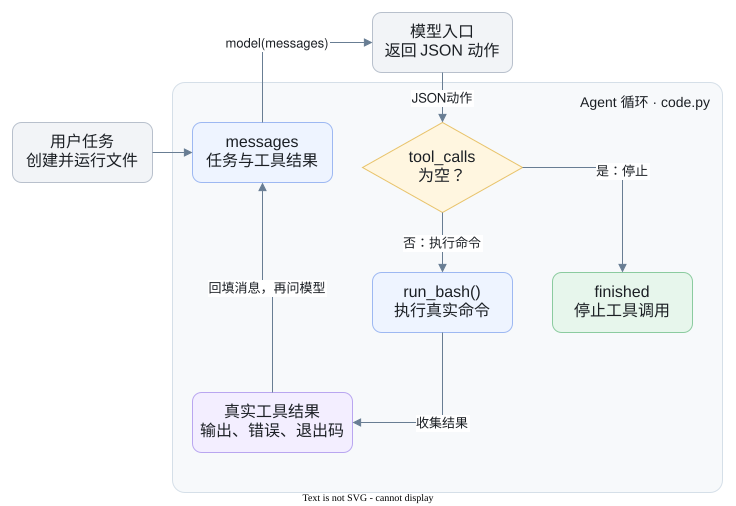
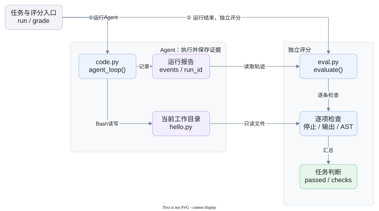

# e01: 模型停下了，任务完成了吗？

`e01` → [e02](../e02_samples/README.zh.md) → e03 → … → e16

> 先让动作发生，再看它留下的结果。

## 问题

让模型创建 `hello.py`，里面只有 `print("Hello, World!")`，然后运行它。

模型回复“已完成”。你打开目录，文件却不存在。模型能描述一个动作，但文件要靠工具来写。即使工具执行过，也还要看看结果是否符合要求。

这一课把这两件事接起来：一个循环执行动作，一个评分函数检查实际结果。

## 解决方案

模型收到任务，提出 Bash 命令。循环执行命令，把输出交回模型。模型不再调用工具时，循环结束。

运行结束后，评分器读取执行记录和实际文件。最终回答中的“完成”，不会自动变成完成证据。





## 工作原理

先放入用户任务：

```python
messages = [{"role": "user", "content": task}]
```

将消息交给模型，再把回答追加进去：

```python
response = model(messages)
reply = response["reply"]
messages.append({"role": "assistant", "content": reply})
```

模型没有动作，循环就结束：

```python
if not reply["tool_calls"]:
    run.update(status="finished", final_answer=reply["answer"])
    break
```

`finished` 记录停止原因。它没有读过 `hello.py`，当然也不知道文件是否正确。

有动作时，执行 Bash，保存真实结果，再送回模型：

```python
result = run_bash(call["command"], workspace)
results.append(result)
# 完成这一批动作后：
messages.append({"role": "tool", "content": results})
```

`stdout`、`stderr` 和退出码来自实际进程。模型下一轮可以据此继续工作。完整循环见 [code.py](code.py)。模型传输和进程控制在共享运行模块中，不影响这条主线。

接着看 [eval.py](eval.py)。它检查三件事：模型正常停止、成功命令输出指定文字、当前文件符合指定的单条 `print`。

```python
return {"passed": all(checks.values()), "checks": checks}
```

三条条件全部满足，才接受这次任务。文件内容用语法树比较，所以单引号、双引号和注释差异不会影响判断。这条规则只适用于本题要求的结构。

只执行 `echo 'Hello, World!'` 可以产生正确文字，却没有正确文件。只回复“完成”，则连动作证据也没有。逐项检查让这些差别显现出来。

## 增加了什么

| 部分 | 作用 |
|---|---|
| 循环 | 请求模型、执行动作、回填结果 |
| Bash | 真正操作文件并返回输出 |
| 运行记录 | 留下发生过的动作与结果 |
| 评分器 | 根据任务条件检查记录和文件 |

循环有步数上限，超过上限记为 `step_limit`；模型请求失败记为 `model_error`。两种情况都保留已发生的动作。

## 试一下

```sh
python -m course.run e01 --case hello
```

1. 让模型直接返回空动作和“已完成”，看看停止状态与评分有什么区别。
2. 完成任务后改掉 `hello.py` 的输出，再评分。旧记录还能让文件检查通过吗？
3. 把正确文件改成单引号并增加注释，看看语法树发生了什么变化。

[源码导读](source_walkthrough.md) · [练习](exercises.md) · [参考解释](solutions.md) · [样本与评测记录](assessment.md)

## 接下来

下一课给动作命名，并把一次运行整理成评测框架可以读取的样本。
