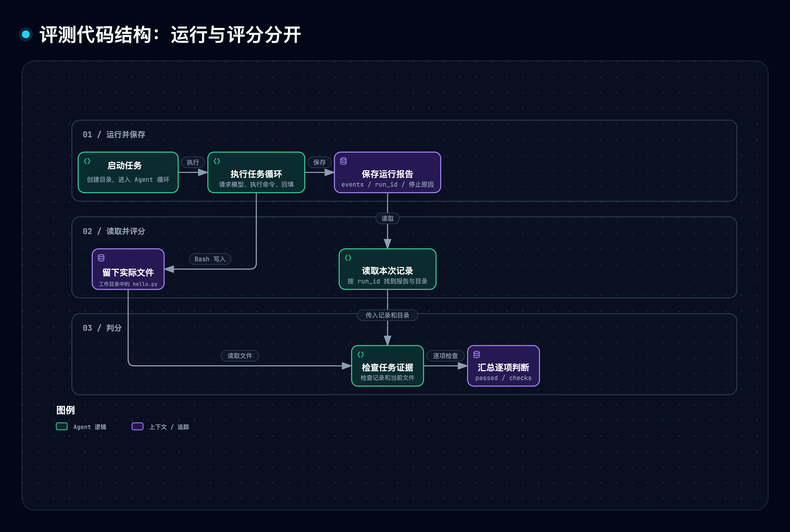

# e01 源码导读：完成声明与完成证据

[教材](README.zh.md) · [循环](code.py) · [评分](eval.py)

[打开交互图：点击节点看说明，点击“静态”播放流程](https://lovits.github.io/learn-agent-evaluation/diagrams/evaluation-code.html)

## 从循环读到文件

`agent_loop` 接收任务与工作目录，返回停止状态、最终回答和动作记录。`messages` 给模型继续工作，`events` 留给外部读取。

`run_bash` 返回真实进程输出、退出码、超时与截断状态。循环把它回填给模型，同时保存到事件中。模型连接、进程控制与初始目录处理见 [runtime.py](../../eval_course/runtime.py)。独立目录防止上轮产物混入；Bash 的教学阻断词不构成完整权限边界。

`evaluate` 读记录与当前 `hello.py`，逐项判断。AST 比较检查指定结构，stdout 命中检查出现过指定文字；两者不能证明任意程序行为正确，也不能单独证明输出来自某个特定文件。任务完成度一课会继续讨论行为检查。

## 对照 Learn Claude Code

固定版本的 [s01 循环](https://github.com/shareAI-lab/learn-claude-code/blob/448c75bb596917ad196cc1fb7558f459c5c50fdd/s01_agent_loop/code.py) 也是请求模型、执行工具、回填结果，没有工具调用就返回。

本课用 JSON 动作适配模型入口。模型负责提出动作；Bash 由课程运行框架执行。评分放在循环之外。

## DeepEval 中的三个角色

读 [Golden](https://github.com/confident-ai/deepeval/blob/34db63dd005ebc9a905c8ef4741ae0687c93c14c/deepeval/dataset/golden.py)、[LLMTestCase](https://github.com/confident-ai/deepeval/blob/34db63dd005ebc9a905c8ef4741ae0687c93c14c/deepeval/test_case/llm_test_case.py) 和 [evaluate](https://github.com/confident-ai/deepeval/blob/34db63dd005ebc9a905c8ef4741ae0687c93c14c/deepeval/evaluate/evaluate.py)：任务与预期、实际输出、指标执行分别组织。

[官方评测概念](https://deepeval.com/docs/evaluation-introduction)用于理解这套分工。本课自己的文件规则承担评分职责，尚未调用原生 SDK 指标。

## Ragas 中的对应关系

[Dataset](https://github.com/vibrantlabsai/ragas/blob/8c63f10d500c44efbf24fdb9e2920de2104c321c/src/ragas/dataset.py) 组织数据，[ExperimentWrapper.arun](https://github.com/vibrantlabsai/ragas/blob/8c63f10d500c44efbf24fdb9e2920de2104c321c/src/ragas/experiment.py) 对数据行调用实验函数并收集返回值。业务上的成功条件仍需由规则或指标定义。

本课借鉴分工，下一课才构造实际 SDK 样本。先看清预期从哪里来、实际发生了什么，才有可解释的评分输入。

任务入口在 [course.run](../run.py)，它读取本课样本、创建本次目录并调用循环；[course.grade](../grade.py) 根据运行编号读取结果，再进入本课评分函数。

[样本与评测记录](assessment.md)
