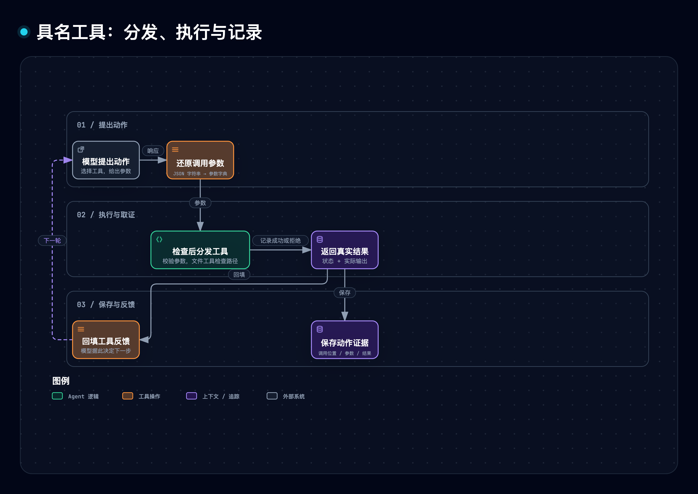
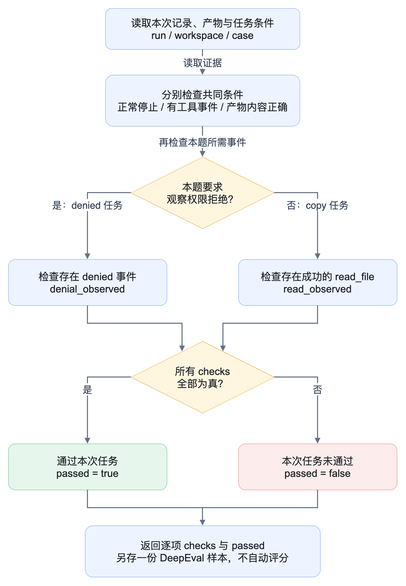

# e02: 一次运行，一份样本

[e01](../e01_success/README.zh.md) → `e02` → [e03](../../docs/curriculum.md#03-准备评测数据) → … → e16

> 记录动作时，把它的参数和结果一起留下。

## 问题

上一课能让 Agent 创建文件，也能判断文件是否符合要求。现在把两次运行摆在一起：它们最后都回答“完成”，其中一次正确写入，另一次写入被拒绝。

只看最终回答，看不出差别。要评价 Agent，就需要知道它试过什么、哪里失败，以及最后留下了什么。

这一课把一次运行保存成样本。先给动作命名，再保存名字、参数和执行结果，最后转换成 DeepEval 的评测样本。

[](https://lovits.github.io/learn-agent-evaluation/diagrams/tool-recording.html)

[打开交互图：点击节点看说明，点击“静态”播放流程](https://lovits.github.io/learn-agent-evaluation/diagrams/tool-recording.html)

## 解决方案

给动作起名字，并把参数和执行结果留在同一条事件中。评分时就能从样本追回实际执行。

## 工作原理

### 从命令到具名动作

读文件原来是 `cat source.txt`。换成具名工具，意图就能直接表达为：

```python
{"name": "read_file", "arguments": {"path": "source.txt"}}
```

本课保留 Bash，再加入 `read_file` 和 `write_file`。这两个工具都能由 Bash 完成；具名参数让记录更容易解释，也让文件权限有明确的检查位置。

模型只提出动作。实际发生什么，仍由执行框架决定。

### 工具分发

[tools.py](tools.py) 用一个字典找到处理函数：

```python
HANDLERS = {
    "bash": run_bash,
    "read_file": read_file,
    "write_file": write_file,
}
```

执行时，查表，再传参数：

```python
output = HANDLERS[name](workspace=workspace, **arguments)
```

工具描述告诉模型可用的名字和参数，处理函数负责执行。循环里的“请求、执行、回填、判停”继续保留，完整代码见 [code.py](code.py)。

传输时，参数放在 `arguments_json` 字符串里；进入循环后用 `json.loads` 还原成字典。运行记录保存还原后的参数，后面不用再从命令文字里猜。

### 先判断能不能做，再记录做得怎样

文件工具执行前，先解析路径：

```python
target = (workspace / path).resolve()
if not target.is_relative_to(workspace.resolve()):
    raise PermissionError("Path is outside the workspace")
```

因此，`write_file("../outside.txt", ...)` 在写入之前就被拒绝。这里限制的是具名文件工具；Bash 仍是上一课的教学执行器。

[execute](tools.py) 将结果分成几种状态：

| 状态 | 发生了什么 |
|---|---|
| `ok` | 工具正常执行 |
| `denied` | 权限检查拒绝，动作没有执行 |
| `invalid` | 工具名或参数不符合定义 |
| `error` | 执行过程中出错，例如文件不存在 |

Bash 还可能返回 `blocked` 或 `timeout`。这些状态都来自执行框架。模型说“写好了”，不会把 `denied` 改成 `ok`。

### 把动作和结果放在同一条记录里

循环执行每个动作后，立即保存：

```python
run["events"].append(
    {
        "id": f"{step}.{index}",
        "name": call["name"],
        "arguments": arguments,
        "result": result,
    }
)
```

`step` 是第几次模型响应，`index` 是这一批里的第几个动作。两者标记调用位置；外层 `run_id` 标记整次运行。公开任务的 `id` 在报告中记为 `case_id`。同一任务重跑，要有新的 `run_id`。

这就是轨迹的起点：同一次运行中的动作按发生顺序保存。本课用位置编号表达归属，尚未引入完整的 span 平台。

结果同时回填给模型。记录保留的是已发生的过程；消息历史保留模型当时实际看到了什么。

### 从记录到 DeepEval 样本

[samples.py](samples.py) 不再运行 Agent，只转换已有记录。

DeepEval 接收任务、最终回答和工具调用：

```python
LLMTestCase(
    input=run["task"],
    actual_output=run["final_answer"] or "",
    tools_called=[
        ToolCall(name=e["name"], input_parameters=e["arguments"], output=e["result"])
        for e in run["events"]
    ],
)
```

本课把拒绝或报错也保存在调用的 `output` 中。`tools_called` 表示提出并经过处理的调用记录，不能单凭列表里的工具名推断动作已成功。

转换得到的是评分输入。创建样本不会自动产生分数，也不会确认任务完成。停止状态和运行编号仍保存在外层记录里；缺少最终回答时保留空文本，不拿预期答案补进去。

## 相对上一课的变更

| 部分 | e01 | e02 |
|---|---|---|
| 动作 | Bash 命令 | 工具名和参数 |
| 执行 | 直接调用 Bash | 查表分发，文件工具检查路径 |
| 记录 | 命令与结果 | 调用位置、名字、参数与结果 |
| 样本 | 本课运行报告 | 从同一报告转换成真实 SDK 对象 |

[eval.py](eval.py) 仍用小任务规则检查实际文件，样本导出单独保存。更多评分方法从第4课展开。

评测先检查共同条件，再按任务选择读取成功或权限拒绝这条证据，最后汇总所有检查。

[](https://lovits.github.io/learn-agent-evaluation/diagrams/e02-task-evaluation.svg)

[放大查看评测流程](https://lovits.github.io/learn-agent-evaluation/diagrams/e02-task-evaluation.svg)

## 试一下

```sh
python -m course.run e02 --case copy
```

1. 完成 `copy`：读取 `source.txt`，写入 `result.txt`，再读回来。沿记录找到三个动作及其结果。
2. 完成 `denied`：用文件工具尝试越界写入，观察拒绝，再写入允许的文件。哪里记录了“尝试过”，哪里说明“没有执行”？
3. 去掉一条工具结果，只保留最终回答。哪些问题还可以评价，哪些已经没有证据？
4. 同一任务运行两次，比较任务编号、运行编号和动作位置的作用。

[源码导读](source_walkthrough.md) · [练习](exercises.md) · [参考解释](solutions.md) · [样本与评测记录](assessment.md)

## 接下来

下一课先挑选值得反复运行的任务，为它们准备参考和数据划分。
