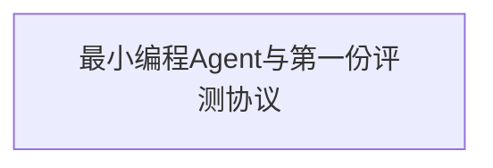

# Tutorial: e01_agent_baseline

模型给动作，Docker里的循环执行Bash，独立容器核实结果。

**Source Repository:** [None](None)

## Chapters

1. [最小编程Agent与第一份评测协议](01_最小编程agent与第一份评测协议.md)

---

Generated by [AI Codebase Knowledge Builder](https://github.com/The-Pocket/Tutorial-Codebase-Knowledge)