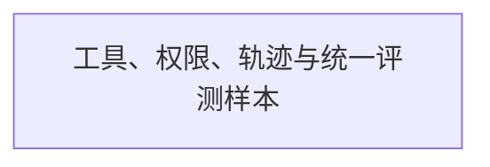

# Tutorial: e02_tools_traces

模型给动作，Docker里的循环执行Bash，独立容器核实结果。

**Source Repository:** [None](None)

## Chapters

1. [工具、权限、轨迹与统一评测样本](01_工具_权限_轨迹与统一评测样本.md)

---

Generated by [AI Codebase Knowledge Builder](https://github.com/The-Pocket/Tutorial-Codebase-Knowledge)