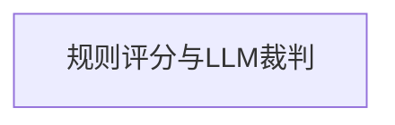

# Tutorial: e03_judges

模型给动作，Docker里的循环执行Bash，独立容器核实结果。

**Source Repository:** [None](None)

## Chapters

1. [规则评分与LLM裁判](01_规则评分与llm裁判.md)

---

Generated by [AI Codebase Knowledge Builder](https://github.com/The-Pocket/Tutorial-Codebase-Knowledge)