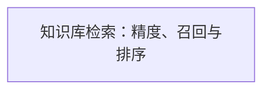

# Tutorial: e04_retrieval

模型给动作，Docker里的循环执行Bash，独立容器核实结果。

**Source Repository:** [None](None)

## Chapters

1. [知识库检索：精度、召回与排序](01_知识库检索_精度_召回与排序.md)

---

Generated by [AI Codebase Knowledge Builder](https://github.com/The-Pocket/Tutorial-Codebase-Knowledge)