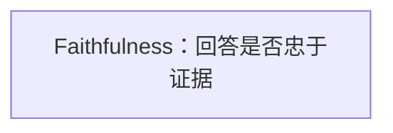

# Tutorial: e05_faithfulness

模型给动作，Docker里的循环执行Bash，独立容器核实结果。

**Source Repository:** [None](None)

## Chapters

1. [Faithfulness：回答是否忠于证据](01_faithfulness_回答是否忠于证据.md)

---

Generated by [AI Codebase Knowledge Builder](https://github.com/The-Pocket/Tutorial-Codebase-Knowledge)