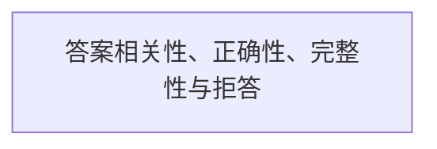

# Tutorial: e06_answer_quality

以版本化参考答案和拒答政策，区分切题、正确、完整与语义相似。

**Source Repository:** [None](None)

## Chapters

1. [答案相关性、正确性、完整性与拒答](01_答案相关性_正确性_完整性与拒答.md)

---

Generated by [AI Codebase Knowledge Builder](https://github.com/The-Pocket/Tutorial-Codebase-Knowledge)