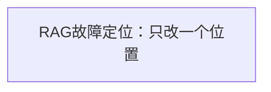

# Tutorial: e07_failure_diagnosis

固定任务，逐段加入资料、检索和生成故障开关，再沿阶段证据定位。

**Source Repository:** [None](None)

## Chapters

1. [RAG故障定位：只改一个位置](01_rag故障定位_只改一个位置.md)

---

Generated by [AI Codebase Knowledge Builder](https://github.com/The-Pocket/Tutorial-Codebase-Knowledge)