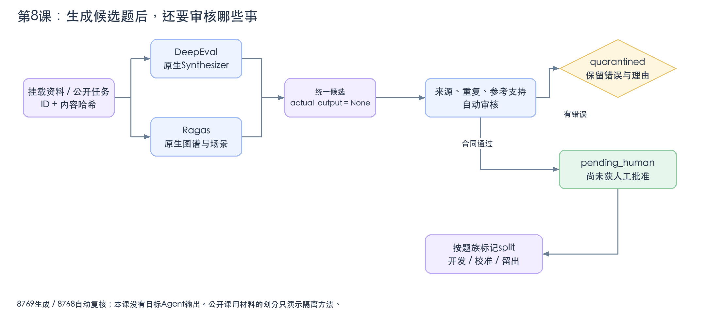

# e08: 评测数据集 — 一道题要带哪些东西

[课程](https://github.com/lovits/learn-agent-evaluation/blob/main/README.md) · [上一课](https://github.com/lovits/learn-agent-evaluation/blob/main/lessons/e07_failure_diagnosis/README.zh.md) · [下一课](https://github.com/lovits/learn-agent-evaluation/blob/main/lessons/e09_comparison/README.zh.md) · [源码导读](https://github.com/lovits/learn-agent-evaluation/blob/main/lessons/e08_datasets/source_walkthrough.md)

> 保存任务、参考和来源，下次才能评价同一个问题。

## 只有问题列表还不够

上一课发现 Agent 漏写上传限额。把“上传上限是多少”存下来，过几天再问一次，未必能重现原问题：文档可能已改版，问题可能不再要求同一版本。

一条评测数据需要把任务与当时的成功条件绑在一起。生成器可以帮我们扩充问题，但生成的参考也需要检查。

## 先定义候选

本课的候选保存这些信息：

| 字段 | 用处 |
|---|---|
| `question / reference` | 要问什么、依据什么判断 |
| `evidence` | 文档 ID 与内容哈希 |
| `family / query_type` | 属于哪类任务、单跳还是多跳 |
| `answerable` | 指定证据内能否回答 |
| `origin / review_status` | 从哪里产生、审核到哪一步 |
| `actual_output` | 被测 Agent 真正运行后的输出 |

准备题目时，`actual_output=None`。参考答案不能复制成实际输出。编程题还要保存文件与行为合同，例如修改后的输出应为48。



## DeepEval 从上下文生成 Golden

[`code.py`](https://github.com/lovits/learn-agent-evaluation/blob/main/lessons/e08_datasets/code.py) 把已经选好的文档交给原生 Synthesizer：

```python
goldens = synthesizer.generate_goldens_from_contexts(
    contexts=[[d["text"] for d in docs]],
    max_goldens_per_context=1,
    include_expected_output=True,
    source_files=[[d["id"] for d in docs]],
    context_chunk_source_files=[[d["id"] for d in docs]],
    _send_data=False,
)
```

先生成问题，再经过质量反馈、重写与演化，最后生成参考。Reasoning 可以增加推理要求，Multi-context 可以让问题利用多份上下文。

质量分不是最终通行证。固定版本在重试用完后仍可能保留低分输入，后续演化又会改变题目，因此最后还要审核。

## Ragas 先构图，再生成场景

两份规范都谈 `POST /upload`，可以用这个共同实体建立关系：

```text
认证文档 ── POST /upload ── 限额文档
```

本课用规则提取真实共同端点，构造原生 `KnowledgeGraph`。没有共同端点就停止，不凭空造关系。

`TestsetGenerator` 再依据 persona、节点和关系组织 scenario，生成问题与参考。persona 在这里是编写的 Python 开发者角色。

单跳只依赖一份资料，多跳需要跨来源组合。把两篇文档放进输入，并不保证生成的问题真正依赖两篇，所以还要问：去掉其中一篇，它是否仍能回答？

## 参考也要评分

生成之后，另一次审核检查 reference 是否受给定证据支持，以及多跳题是否确实需要多来源。

这还是模型判断。自动通过后，候选保持 `pending_human`，等待人工确认。对于“会重试几次”这类不可回答题，参考应说明未知，不能猜数字。

本课从预构建图进入生成器，没有运行向量化的默认构图流程；源码导读会区分两条路径。

## 去重和划分一起考虑

[`dataset.py`](https://github.com/lovits/learn-agent-evaluation/blob/main/lessons/e08_datasets/dataset.py) 先归一化问题，再检查重复：

```python
cluster = clusters[question_key(row["question"])]
duplicate_of = cluster[0]["id"] if cluster[0]["id"] != row["id"] else None
if len({r["family"] for r in cluster}) > 1:
    errors.append("cross_family_duplicate")
elif duplicate_of:
    errors.append("duplicate_question")
```

词面归一化能发现大小写或标点变化，语义改写仍需复核。同一任务的不同版本应留在同一题族，再按题族划分开发、校准和留出集，避免近似题跨集。

来源哈希变化时，参考也要重新检查。课程里的公开样例适合练习划分方法，正式留出集还需要未参与开发的任务。

## 试一下

从认证与限额两份资料写一道单跳题、一道确实需要两份资料的题，以及一道证据不足的题。给每题补上 reference、来源和可回答性。

再为其中一道改写措辞：它应作为独立题，还是同一题族的变体？为什么？

[生成入口](https://github.com/lovits/learn-agent-evaluation/blob/main/lessons/e08_datasets/code.py) · [数据审核](https://github.com/lovits/learn-agent-evaluation/blob/main/lessons/e08_datasets/dataset.py) · [练习](https://github.com/lovits/learn-agent-evaluation/blob/main/lessons/e08_datasets/exercises.md) · [参考答案](https://github.com/lovits/learn-agent-evaluation/blob/main/lessons/e08_datasets/solutions.md)

## 接下来

任务与标准保存好以后，就可以反复用于两个版本。下一课先把同一任务配对，再讨论平均分与不确定性。


# e08 源码导读：生成器为什么不能代替数据审核

[教材](https://github.com/lovits/learn-agent-evaluation/blob/main/lessons/e08_datasets/README.zh.md) · [生成器接入](https://github.com/lovits/learn-agent-evaluation/blob/main/lessons/e08_datasets/code.py) · [数据合同](https://github.com/lovits/learn-agent-evaluation/blob/main/lessons/e08_datasets/dataset.py)

## DeepEval 的生成链

[Synthesizer 指南](https://deepeval.com/guides/guides-using-synthesizer) · [实现](https://github.com/confident-ai/deepeval/blob/34db63dd005ebc9a905c8ef4741ae0687c93c14c/deepeval/synthesizer/synthesizer.py) · [配置](https://github.com/confident-ai/deepeval/blob/34db63dd005ebc9a905c8ef4741ae0687c93c14c/deepeval/synthesizer/config.py)

```text
指定 contexts
  → _generate_inputs
  → _rewrite_inputs / InputFeedback
  → _evolve_input
  → 风格加工
  → Golden + expected_output
```

`FiltrationConfig` 规定 critic 与重试；`EvolutionConfig` 规定演化分布；`StylingConfig` 规定风格。

`_rewrite_inputs` 达阈值时停止重写，耗尽重试时仍可追加最后输入。`synthetic_input_quality` 属于当时反馈，不保证之后演化与风格加工后的质量。`used_source_files` 同样不能证明最终问题必须使用每个来源。

本课从已准备的上下文开始，分别固定 Reasoning 与 Multi-context，便于沿原文检查参考。异步批处理可以并发处理上下文，审核职责不因此改变。

## Ragas 从图到样本

[数据生成概念](https://docs.ragas.io/en/stable/concepts/test_data_generation/rag/) · [graph.py](https://github.com/vibrantlabsai/ragas/blob/8c63f10d500c44efbf24fdb9e2920de2104c321c/src/ragas/testset/graph.py) · [生成编排](https://github.com/vibrantlabsai/ragas/blob/8c63f10d500c44efbf24fdb9e2920de2104c321c/src/ragas/testset/synthesizers/generate.py)

`build_graph` 为真实文档建立原生 DOCUMENT 节点，通过共同端点建立 `entities_overlap` 关系。这是课程自己的规则构图。

`TestsetGenerator.generate` 接收预构建图、persona 与 query distribution，先分配 scenario，再生成 sample。本课这条路径不需要 embeddings；不能把这个参数设置直接套到需要默认 transforms 的文档入口。

[具体单跳](https://github.com/vibrantlabsai/ragas/blob/8c63f10d500c44efbf24fdb9e2920de2104c321c/src/ragas/testset/synthesizers/single_hop/specific.py) 从实体节点组织场景，再由[单跳基类](https://github.com/vibrantlabsai/ragas/blob/8c63f10d500c44efbf24fdb9e2920de2104c321c/src/ragas/testset/synthesizers/single_hop/base.py)生成 query/answer。

[具体多跳](https://github.com/vibrantlabsai/ragas/blob/8c63f10d500c44efbf24fdb9e2920de2104c321c/src/ragas/testset/synthesizers/multi_hop/specific.py) 沿实体重合关系取节点组合，[多跳基类](https://github.com/vibrantlabsai/ragas/blob/8c63f10d500c44efbf24fdb9e2920de2104c321c/src/ragas/testset/synthesizers/multi_hop/base.py)用带 hop 标记的上下文生成问答。节点数量与问题的真实多跳需求仍要分别审核。

## 统一结构接在生成器外面

`candidate` 映射问题、reference、证据、题族和来源，把实际输出留空。自动参考审核返回支持关系、多来源需求和理由，不能据此写成人工通过。

`structure_errors` 检查必要字段与来源版本；`question_key` 使用 NFKC、casefold 和去标点识别词面重复；Jaccard 只给近似提示。数值差异保留，不把1 MiB与2 MiB当成同一个事实。

跨题族重复要隔离，避免相同任务换标签后进入不同集合。同族重复保留首条，其余保存 `duplicate_of`。

## 最后审核哪几件事

检查来源是否仍是同一版本，reference 是否完整，answerable 是否正确，问题是否真需要多来源，以及题族是否跨集。`difficulty` 和 persona 都是生成条件或标签，需要单独校准。

`eval.py` 可以重算这些结构合同，语义参考仍需人工审核。数据通过结构检查与 Agent 在数据上表现良好，是两件独立的事。


---

Generated by [AI Codebase Knowledge Builder](https://github.com/The-Pocket/Tutorial-Codebase-Knowledge)