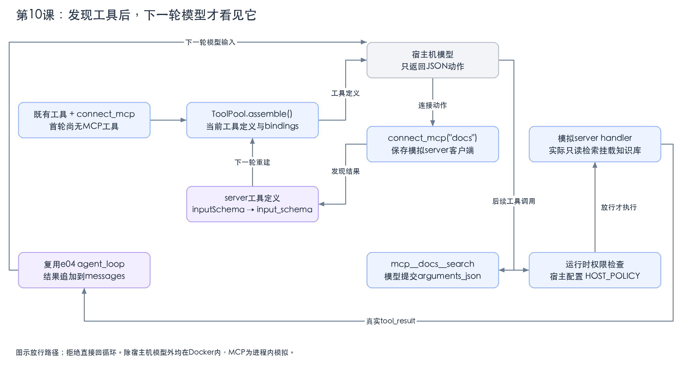

# e10: 工具调用质量 — 名字对了，还要看参数

[课程](https://github.com/lovits/learn-agent-evaluation/blob/main/README.md) · [上一课](https://github.com/lovits/learn-agent-evaluation/blob/main/lessons/e09_comparison/README.zh.md) · [下一课](https://github.com/lovits/learn-agent-evaluation/blob/main/lessons/e11_task_completion/README.zh.md) · [源码导读](https://github.com/lovits/learn-agent-evaluation/blob/main/lessons/e10_tool_evaluation/source_walkthrough.md)

> 工具匹配、执行成功和任务完成，各自需要证据。

## read_file 读错文件算对吗

Agent 需要读取程序，把 `6 * 7` 改成 `6 * 8`，运行并保存结果。它确实调用了 `read_file`，但读的是另一个文件。

只数工具名，会把这次调用当成命中。再往下看，还可能发生漏调用、顺序错误，或用不同合法方法完成修改。

本课通过动态工具池连接新的工具来源，重点看每种工具指标究竟比较哪一部分。

## 工具先发现，下一轮才能选择

本课沿用 Learn Claude Code s14 的进程内 MCP 模拟：连接配置好的 docs 服务，发现 `mcp__docs__search`，下一轮再把它交给模型。



模型调用前重新组装工具：

```python
def model(messages):
    tools = pool.assemble()
    snapshots.append({"model_turn": len(snapshots) + 1, "tools": tools})
    return call_model(messages, tools)
```

`ToolPool` 保存规范化工具名与实际处理器的绑定。宿主策略决定能否运行，服务端的“只读”描述不能自己授予权限。

这里关注发现与分发，没有实现 MCP 的 stdio 或 HTTP 线协议。

## 先确定比较单位

| 比较单位 | 能发现什么 | 容易漏什么 |
|---|---|---|
| 工具名 | 选择了哪种动作 | 参数错误 |
| 名字与参数 | 路径、内容等是否匹配 | 先后顺序 |
| 调用序列 | 是否按要求先读后改 | 其他合法执行路径 |
| 调用集合 | 覆盖与多余调用种类 | 相同调用的重复次数 |
| 实际产物 | 业务是否完成 | 过程中的越权或浪费 |

参考轨迹是一条可行路径。除非任务明确要求路线，否则不能把它当成唯一正确解。

## DeepEval 的配置改变匹配规则

`ToolCorrectnessMetric` 默认按工具名与类型匹配。加入参数评价以后，再比较 `input_parameters`；开启 ordering 后，按加权最长公共子序列计算覆盖；exact match 则严格比较整个列表。

```python
metric = ToolCorrectnessMetric(
    model=model, eval_mode="llm", async_mode=False, **options
)
scores[name] = metric.measure(sample, _show_indicator=False)
```

`options` 在 [`metrics.py`](https://github.com/lovits/learn-agent-evaluation/blob/main/lessons/e10_tool_evaluation/metrics.py) 中分别设置这些策略。仅凭类名无法知道这次用了哪一种。

非精确覆盖以预期调用数为分母，额外重复调用不一定扣分。传入 `available_tools` 时，原生实现还会请求模型判断工具选择，再取选择分与匹配分的较小值。

## Ragas 的序列与集合

`ToolCallAccuracy` 先检查名字序列对齐，再比较参数。flexible 模式允许调整顺序，但重复导致长度不同仍可能失败。

`ToolCallF1` 把完整 `(name, args)` 放入集合，用交集计算 precision、recall 和 F1。相同调用重复一次不会产生新集合元素。

手算假设正确三次调用后，又重复同一次读取：集合 F1 可以仍为1，严格序列却不通过。次数与效率应另行观察。

## 评价参数，要看当时知道什么

`ArgumentCorrectness` 让裁判判断参数是否合理。输入必须保留决策时已有的消息和工具结果。

```text
此前消息 + 已返回结果 → 当前模型决定 → 本轮工具调用
```

[`decision_contexts`](https://github.com/lovits/learn-agent-evaluation/blob/main/lessons/e10_tool_evaluation/metrics.py) 先回填上一轮结果，再构造本轮评分输入。它不把本轮尚未发生的结果塞回过去，也不裁掉连接和资料后，再指责模型没有依据。

参数通过 schema、权限放行、执行成功和裁判认为合理，仍是不同判断。最终文件还要按业务要求检查。

## 试一下

保留工具名，换成错误路径；再保留正确参数，只交换顺序；最后重复一次相同调用。预测不同配置会给出什么判断。

再比较 `edit_file` 与 `write_file` 两种合法修改路径：哪一种条件是用户要求，哪一种只是参考实现的写法？

[动态工具](https://github.com/lovits/learn-agent-evaluation/blob/main/lessons/e10_tool_evaluation/mcp_tools.py) · [工具指标](https://github.com/lovits/learn-agent-evaluation/blob/main/lessons/e10_tool_evaluation/metrics.py) · [练习](https://github.com/lovits/learn-agent-evaluation/blob/main/lessons/e10_tool_evaluation/exercises.md) · [参考答案](https://github.com/lovits/learn-agent-evaluation/blob/main/lessons/e10_tool_evaluation/solutions.md)

## 接下来

工具层的正确不足以保证代码任务完成。下一课进入真实行为检查，并把这些检查写成自定义指标。


# e10 源码导读：每个匹配开关改变了什么

[教材](https://github.com/lovits/learn-agent-evaluation/blob/main/lessons/e10_tool_evaluation/README.zh.md) · [工具池](https://github.com/lovits/learn-agent-evaluation/blob/main/lessons/e10_tool_evaluation/mcp_tools.py) · [指标](https://github.com/lovits/learn-agent-evaluation/blob/main/lessons/e10_tool_evaluation/metrics.py)

## MCP 的绑定与授权

上游 [s14](https://github.com/shareAI-lab/learn-claude-code/blob/448c75bb596917ad196cc1fb7558f459c5c50fdd/s14_mcp_plugin/code.py) 使用进程内服务。本课 `connect_mcp` 保存客户端，`assemble` 转换 schema 并建立名字绑定，每轮更新可见工具快照。

绑定从内部表读取，参数不能覆盖实际客户端或原始工具名。规范化后检查名字冲突与长度。`HOST_POLICY` 独立判断授权，再进入处理器的参数校验。

## DeepEval ToolCorrectness

[文档](https://deepeval.com/docs/metrics-tool-correctness) · [实现](https://github.com/confident-ai/deepeval/blob/34db63dd005ebc9a905c8ef4741ae0687c93c14c/deepeval/metrics/tool_correctness/tool_correctness.py)

- 默认匹配工具名与类型，非精确分母为预期调用数。
- `INPUT_PARAMETERS` 启用递归参数比较，按双方键的并集计权，多余键可能扣分。
- `should_consider_ordering` 使用加权最长公共子序列，仍按预期数归一化。
- `should_exact_match` 要求长度、位置、名称、类型及选中的参数或输出全部匹配，优先于 ordering。
- `available_tools` 触发模型选择评分，最后取它与匹配分的较小值。

因此 strict mode、exact match、ordering 不是同一个开关。额外调用未必降低覆盖分，效率需另评。

## Ragas ToolCallAccuracy

[Agent 指标说明](https://docs.ragas.io/en/stable/concepts/metrics/available_metrics/agents/) · [实现](https://github.com/vibrantlabsai/ragas/blob/8c63f10d500c44efbf24fdb9e2920de2104c321c/src/ragas/metrics/collections/tool_call_accuracy/metric.py) · [参数比较](https://github.com/vibrantlabsai/ragas/blob/8c63f10d500c44efbf24fdb9e2920de2104c321c/src/ragas/metrics/collections/tool_call_accuracy/util.py)

从 `AIMessage` 取调用后，严格模式比较完整工具名序列；flexible 排序后比较，仍受长度与多重集影响。

参数比较遍历参考键，再以字符串比较值。额外预测键可能不扣分，整数与同形字符串也可能匹配。实际 handler 的 schema 仍可能拒绝该调用。名字对齐后还可能有参数部分分。

## Ragas ToolCallF1

[实现](https://github.com/vibrantlabsai/ragas/blob/8c63f10d500c44efbf24fdb9e2920de2104c321c/src/ragas/metrics/collections/tool_call_f1/metric.py) · [可哈希转换](https://github.com/vibrantlabsai/ragas/blob/8c63f10d500c44efbf24fdb9e2920de2104c321c/src/ragas/metrics/collections/tool_call_f1/util.py)

名字与完整参数转成可哈希集合，TP 为交集，FP 为多余种类，FN 为遗漏种类。顺序和相同调用的重复次数被丢掉。

固定实现双方空调用时 F1 为0，Accuracy 为1；第3课自写集合函数选择了另一种空集约定。先判断任务是否应调用工具，再解释这些默认值。

## ArgumentCorrectness 的输入来自哪轮

[文档](https://deepeval.com/docs/metrics-argument-correctness) · [实现](https://github.com/confident-ai/deepeval/blob/34db63dd005ebc9a905c8ef4741ae0687c93c14c/deepeval/metrics/argument_correctness/argument_correctness.py) · [trace 适配](https://github.com/confident-ai/deepeval/blob/34db63dd005ebc9a905c8ef4741ae0687c93c14c/deepeval/metrics/argument_correctness/utils.py)

它根据 `input/tools_called` 生成 yes/no 裁决，再按有效 yes 比例聚合。空调用在固定版本直接返回1，不请求裁判；缺少判定不应被误作全部通过。

原生 trace 适配先定位选择参数的 LLM span。本课用 `parent_id` 重建每轮的已知消息，保留工具定义、连接与检索证据，并核对 verdict 数量。

控制轨迹与真实轨迹分开保存。教学投影只用于相应指标，最终任务仍读实际文件、执行证据和权限状态，接受多种满足合同的合法路径。


---

Generated by [AI Codebase Knowledge Builder](https://github.com/The-Pocket/Tutorial-Codebase-Knowledge)