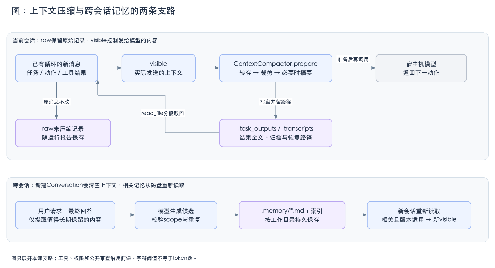

# e12: 跨轮约束 — 新要求来了，旧要求还剩什么

[课程](https://github.com/lovits/learn-agent-evaluation/blob/main/README.md) · [上一课](https://github.com/lovits/learn-agent-evaluation/blob/main/lessons/e11_task_completion/README.zh.md) · [下一课](https://github.com/lovits/learn-agent-evaluation/blob/main/lessons/e13_planning/README.zh.md) · [源码导读](https://github.com/lovits/learn-agent-evaluation/blob/main/lessons/e12_conversation/source_walkthrough.md)

> 明确更新的规则被替换，未更新的约束继续有效。

## 从 300 改成 400，不该顺便改接口

运费任务连续收到需求：先修复函数，再把加急费从300改成400，最后在新会话把重量上限从5000扩到6000。

函数签名始终保持：

```python
shipping_fee(weight_grams, expedited=False)
```

记住旧费用并照用，是过期；改成400却把签名也改了，是丢约束。多轮评测要跟踪每条要求何时生效、何时被明确替换。

本课通过上下文压缩和持久记忆，让这个问题真正出现。

## 模型看到的历史与完整记录分开

`Conversation.visible` 是送给模型的消息；`raw` 保存未压缩动作。内部循环每次传来的 messages 已经累积，不能反复整段追加：

```python
self.visible.extend(copy.deepcopy(messages[seen:]))
seen = len(messages)
if self.compactor:
    self.visible = self.compactor.prepare(self.visible, active_request)
```

`seen` 标记已接入位置。每轮源码快照另存，后面才能按当时版本检查行为。



## 长结果先转存，再压缩旧消息

压缩器先保存完整工具结果，给模型预览与恢复路径；再归档旧中段，必要时才生成摘要：

```python
self.persist_results(messages, recent_only=True)
messages = self.snip(messages)
if size(messages) > self.limit:
    self.persist_results(messages, recent_only=False)
if size(messages) > self.limit:
    messages = self.summarize(messages, active_request)
```

裁剪要保护工具请求与结果配对，也要保留当前用户要求和最近的闭合工具批次。只留下“已经检查过”的摘要，可能丢掉模型继续判断所需的直接证据。

字符阈值只是压缩触发量，不等于模型 token 上限。

## 写盘之后，还得读得回来

[`PagedToolPool`](https://github.com/lovits/learn-agent-evaluation/blob/main/lessons/e12_conversation/tools.py) 扩展 `read_file`，用字符偏移分页恢复：

```python
end = min(len(text), offset + limit)
return policy, {
    "status": "ok",
    "output": text[offset:end],
    "offset": offset,
    "next_offset": end,
    "total_chars": len(text),
    "truncated": end < len(text),
}
```

完整记录存在磁盘、模型收到一个预览、模型收到所有分页，是三个不同事实。`exposure.py` 根据实际模型输入合并已暴露区间，但无法证明模型理解了这些文本。

## 新会话从记忆取什么

新建 `Conversation` 清空旧消息，磁盘记忆仍可召回。候选先区分当前任务与长期事实，只存允许持久化的内容，再按版本筛选。

旧 v1 费用不应覆盖 v3 请求。记忆正文即使包含“改接口、删测试”，也只是背景数据，不会取得高于当前任务与权限的地位。

是否真的保住约束，最后要检查实际动作、签名与文件。

## 多轮指标怎样数

DeepEval `KnowledgeRetention` 从用户消息抽取知识，再判断助手是否遗忘。这里的 `yes` 表示发生遗忘，分数数的是 `no` 比例。

`ConversationCompleteness` 则先抽用户意图，再判断是否满足，这里的 `yes` 才是通过。两个指标的标签极性不同。

Ragas 用 `MultiTurnSample` 表示交互，本课以多轮 AspectCritic 写明“新规则替换旧规则，未改约束继续保持”。会话评分与每轮实际代码行为分开检查。

## 模拟用户也要检查覆盖

模拟器可以生成后续请求，并通过回调运行 Agent：

```python
result = agent.run_turn(input, current_version)
return Turn(
    role="assistant",
    content=result["final_answer"] or "Agent error; see runtime report",
)
```

这是 [`simulate.py`](https://github.com/lovits/learn-agent-evaluation/blob/main/lessons/e12_conversation/simulate.py) 回调的核心。若模拟器第一轮就结束，后面的需求根本没有问到，就不能将其直接算成 Agent 没完成那些需求。

分别记录“问到了哪些阶段”和“收到要求后是否做对”。达到轮数上限也不等于任务完成。

## 试一下

依次提出费用更新和重量上限更新，列出每轮仍然有效的要求。压缩历史后，检查这些要求和最近工具结果在哪里。

再开启新会话，只保留磁盘记忆：旧费用和稳定接口约束，哪一种应当召回？

[会话](https://github.com/lovits/learn-agent-evaluation/blob/main/lessons/e12_conversation/code.py) · [压缩](https://github.com/lovits/learn-agent-evaluation/blob/main/lessons/e12_conversation/context.py) · [记忆](https://github.com/lovits/learn-agent-evaluation/blob/main/lessons/e12_conversation/memory.py) · [练习](https://github.com/lovits/learn-agent-evaluation/blob/main/lessons/e12_conversation/exercises.md) · [参考答案](https://github.com/lovits/learn-agent-evaluation/blob/main/lessons/e12_conversation/solutions.md)

## 接下来

多轮要求已经能跟踪。下一课把目标拆给不同角色，继续检查计划、依赖和交接是否保住整体要求。


# e12 源码导读：什么被保留，什么被评分

[教材](https://github.com/lovits/learn-agent-evaluation/blob/main/lessons/e12_conversation/README.zh.md) · [会话](https://github.com/lovits/learn-agent-evaluation/blob/main/lessons/e12_conversation/code.py) · [压缩](https://github.com/lovits/learn-agent-evaluation/blob/main/lessons/e12_conversation/context.py) · [记忆](https://github.com/lovits/learn-agent-evaluation/blob/main/lessons/e12_conversation/memory.py)

## 三条数据线

`visible` 决定模型实际输入，`raw` 保留完整轨迹，`turns` 保存各轮源码快照。`run_turn` 只接入新增消息，并在返回时补上最后回复，再进入公开停止审查。

检查过去一轮的代码要使用当时快照，不能只读已经被后续轮修改的最终文件。快照重新执行用于检查行为，不代表重新运行了过去的 Agent。

## 压缩如何保护工具协议

上游 [s08](https://github.com/shareAI-lab/learn-claude-code/blob/448c75bb596917ad196cc1fb7558f459c5c50fdd/s08_context_compact/code.py) 包含转存、裁剪、旧结果压缩、模型摘要与超长补救。本课 `prepare` 沿转存最新结果、裁剪、转存旧结果、摘要的顺序处理。

`check_pairs` 防止孤立的工具结果。最新请求独立保留，最近闭合批次不被一条摘要替换。分页恢复继续经过工作区权限；offset 是字符位置，与上游按行参数不同。

`successful_request_text_ranges` 只在请求成功返回后累计暴露区间。`exposure.py` 检查实际送达文本，重复页只计一次。写盘或读取进程拿到全文，不等于模型收到全文。

## 记忆怎样跨会话

上游 [s09](https://github.com/shareAI-lab/learn-claude-code/blob/448c75bb596917ad196cc1fb7558f459c5c50fdd/s09_memory/code.py) 用 Markdown、元数据和索引保存长期内容，还包含整理与回滚。这里保留候选提取、临时范围拒绝、去重、磁盘写入与版本过滤。

召回按词项和显式版本筛选，只有选中正文进入模型。候选仍是模型判断，过滤不构成真实性保证。新会话用新消息列表，证明召回并非偷偷延续旧上下文。

## DeepEval 知识保留

[指南](https://deepeval.com/guides/guides-multi-turn-evaluation) · [KnowledgeRetention 文档](https://deepeval.com/docs/metrics-knowledge-retention) · [实现](https://github.com/confident-ai/deepeval/blob/34db63dd005ebc9a905c8ef4741ae0687c93c14c/deepeval/metrics/knowledge_retention/knowledge_retention.py)

```text
非 assistant 消息 → Knowledge(data)
之前积累的知识 + 当前 assistant → 遗忘裁决
no 比例 → 分数
```

抽取提示支持用户修正事实，但多个旧知识字典仍可能同时参与判断。要查看中间提取结果，确认400替换300没有被误判成遗忘。

空有效裁决默认1；strict mode 在固定源码设阈值1。会话完整性使用另一条路径，参见[文档](https://deepeval.com/docs/metrics-conversation-completeness)与[实现](https://github.com/confident-ai/deepeval/blob/34db63dd005ebc9a905c8ef4741ae0687c93c14c/deepeval/metrics/conversation_completeness/conversation_completeness.py)：先提取 intentions，再数满足意图的 yes 比例。固定实现未按 `window_size` 切窗口，参数存在不代表路径已使用它。

## Ragas 多轮样本与 rubric

[多轮应用说明](https://docs.ragas.io/en/stable/howtos/applications/evaluating_multi_turn_conversations/) · [dataset_schema.py](https://github.com/vibrantlabsai/ragas/blob/8c63f10d500c44efbf24fdb9e2920de2104c321c/src/ragas/dataset_schema.py) · [AspectCritic](https://github.com/vibrantlabsai/ragas/blob/8c63f10d500c44efbf24fdb9e2920de2104c321c/src/ragas/metrics/_aspect_critic.py)

`MultiTurnSample` 保留 Human/AI/Tool 消息序列并检查调用配对。本课旧式 `multi_turn_ascore` 把会话文本送入多轮 prompt，标准写在 definition 中；固定路径没有自动使用 sample.reference。

`strictness=1` 对应一次结果，不能按参数名字推断独立投票数。DeepEval Turn 的角色为 user/assistant，工具细节另存；两框架会话投影的边界都要讲清。

## 模拟覆盖与任务质量分别看

[ConversationSimulator 指南](https://deepeval.com/guides/guides-multi-turn-simulation)说明生成用户与应用回调的连接。`simulate.py` 实际回调 `Conversation.run_turn`，再返回 assistant Turn；场景版本识别仅支持本课约定。

轮数上限、终止控制、场景覆盖和每阶段行为分别记录。若请求尚未提出，缺口属于模拟覆盖；若已经提出但代码违反，则沿 Agent 轨迹继续定位。模拟用户、摘要支持模型与目标 Agent 是不同角色，不应混成一次应用输出。


---

Generated by [AI Codebase Knowledge Builder](https://github.com/The-Pocket/Tutorial-Codebase-Knowledge)