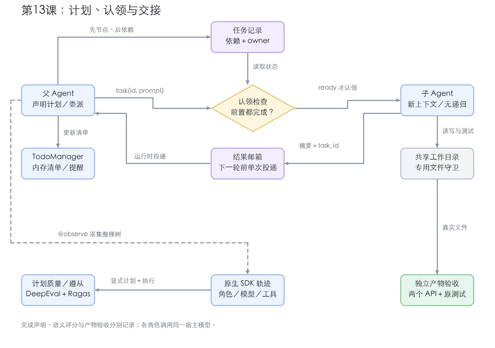

# e13: 计划与协作 — 局部完成怎样接成整体

[课程](https://github.com/lovits/learn-agent-evaluation/blob/main/README.md) · [上一课](https://github.com/lovits/learn-agent-evaluation/blob/main/lessons/e12_conversation/README.zh.md) · [下一课](https://github.com/lovits/learn-agent-evaluation/blob/main/lessons/e14_runtime/README.zh.md) · [源码导读](https://github.com/lovits/learn-agent-evaluation/blob/main/lessons/e13_planning/source_walkthrough.md)

> 计划、执行记录和最终结果，分别评价。

## 两个角色都说完成了

这次修两个文件：`shipping.py` 计算费用，`checkout.py` 的 `quote` 调用它。

核心函数修好，入口却漏传 `expedited`，加急订单仍然算错。即使两个任务都标成 `completed`，整条调用链也没有完成。

本课加入显式计划、任务依赖和一次性子会话，观察局部结果怎样交接，再分别评价计划是否合理、执行是否遵从、整体是否正确。

## 清单说明打算，任务表说明归属

`TodoManager` 保存声明的步骤。更新前先校验整个数组，再整体替换，避免写入半份计划。

```python
if sum(i["status"] == "in_progress" for i in items) > 1:
    raise ValueError("Only one todo may be in_progress")
self.items = copy.deepcopy(items)
self.rounds_without_update = 0
```

清单本身不会修改代码。持久的 `TaskStore` 另存任务 ID、依赖、owner 和状态。

父角色先创建任务，取得真实 ID，再加依赖。核心完成后，入口任务才可以认领。

## 依赖在认领时检查

[`TaskStore.claim`](https://github.com/lovits/learn-agent-evaluation/blob/main/lessons/e13_planning/state.py) 在共享锁内读取依赖，再修改归属：

```python
if any(self.load(d)["status"] != "completed" for d in task["blocked_by"]):
    raise ValueError("Dependencies are incomplete")
task.update(owner=owner, status="in_progress")
return self.save(task, "claim", owner)
```

依赖图还要拒绝环和不存在的节点。记录的 `completed` 是完成声明，工具层的局部检查为它提供依据，整体仍需独立检查。



## 子会话知道什么

[`run_child`](https://github.com/lovits/learn-agent-evaluation/blob/main/lessons/e13_planning/code.py) 给子角色新消息列表，只放任务说明、交接内容和文件范围，不复制父角色全部历史。

```python
pool = PlanningPool(self, owner, task_id, files)
before = copy.deepcopy(task)
result = self.run_session(context, pool)
task = self.store.load(task_id)
```

接口签名、当前费用与测试保护必须明确交接，或让子角色查询知识库。父角色不能假定新会话天然知道前面说过什么。

子角色只能通过专用工具修改分配文件；预期哈希用于拒绝过期覆盖。结果带任务 ID 写入邮箱，由父循环在下一次模型请求前消费一次。

## 原生轨迹把这些关系连起来

DeepEval `@observe` 分别标记 agent、llm 和 tool。父角色调用 `task` 的工具跨度下，会出现真实执行的子 Agent。

```python
@observe(type="tool", name="role_tool")
def dispatch(call, workspace, approve):
    update_current_span(
        name=call["name"],
        input={"actor": pool.actor, "task_id": pool.task_id, "call": copy.deepcopy(call)},
    )
    policy, result = pool.dispatch(call, workspace, approve)
```

这里摘出观察与执行的接入点，完整函数还保存返回值。父子关系帮助我们定位计划、认领和文件修改的来源，函数正常返回并不等于业务完成。

## 计划质量和遵从为什么分开

DeepEval `PlanQuality` 从任务与显式计划判断覆盖和顺序，`PlanAdherence` 再看执行是否符合计划。

好计划可能没有执行完，坏计划也可能被严格照做。固定版本没有提取到计划时默认返回1，必须同时检查“是否有计划”，不能理解成完美规划。

Ragas 在这里用 `DomainSpecificRubrics` 定义质量和遵从的1至5级标准。量尺与输入选择不同，不直接比较两个框架的裸分。

整体检查重新运行核心和入口，确认调用传参、文件范围与保护要求。只有局部通过，仍不足以接受整个项目。

## 试一下

让核心返回正确费用，但让 `quote` 忘记传加急参数。写出一个能区分“核心完成”和“整体完成”的输入。

再比较“好计划未执行”和“坏计划照做”。分别给计划质量、遵从与结果写出判断理由。

[协作循环](https://github.com/lovits/learn-agent-evaluation/blob/main/lessons/e13_planning/code.py) · [任务与邮箱](https://github.com/lovits/learn-agent-evaluation/blob/main/lessons/e13_planning/state.py) · [评分](https://github.com/lovits/learn-agent-evaluation/blob/main/lessons/e13_planning/eval.py) · [练习](https://github.com/lovits/learn-agent-evaluation/blob/main/lessons/e13_planning/exercises.md) · [参考答案](https://github.com/lovits/learn-agent-evaluation/blob/main/lessons/e13_planning/solutions.md)

## 接下来

同步子任务结束以后才能继续。如果一项检查需要等待，下一课把执行放到后台，并评价通知、调度和效率。


# e13 源码导读：计划怎样对应到执行

[教材](https://github.com/lovits/learn-agent-evaluation/blob/main/lessons/e13_planning/README.zh.md) · [运行时](https://github.com/lovits/learn-agent-evaluation/blob/main/lessons/e13_planning/code.py) · [任务状态](https://github.com/lovits/learn-agent-evaluation/blob/main/lessons/e13_planning/state.py) · [角色工具](https://github.com/lovits/learn-agent-evaluation/blob/main/lessons/e13_planning/tools.py)

## 从声明到认领

参考 [s05 清单](https://github.com/shareAI-lab/learn-claude-code/blob/448c75bb596917ad196cc1fb7558f459c5c50fdd/s05_todo_write/code.py)、[s10 任务](https://github.com/shareAI-lab/learn-claude-code/blob/448c75bb596917ad196cc1fb7558f459c5c50fdd/s10_task_system/code.py)、[s06 子 Agent](https://github.com/shareAI-lab/learn-claude-code/blob/448c75bb596917ad196cc1fb7558f459c5c50fdd/s06_subagent/code.py)与 [s13 团队](https://github.com/shareAI-lab/learn-claude-code/blob/448c75bb596917ad196cc1fb7558f459c5c50fdd/s13_agent_teams/code.py)。具体目录以固定版本为准。

本课先验证整份 todo，再替换；任务先建节点再加依赖；`claim` 在同一把 RLock 中检查依赖和 owner。锁保护同一进程共享实例，不提供跨进程分布式认领。

状态以临时文件加 replace 写入。`task_complete` 先运行分配组件的公开行为检查，失败保持进行中；局部通过仍标明整体尚未评估。外部检查还会重放任务事件，防止只看一张全部完成的任务表。

## 上下文与文件分别限制

`run_child` 新建消息，`PlanningPool` 约束可改文件。子任务没有递归委派工具，结果进入 `MessageBus`，由父循环单一消费者读取。

文件哈希守卫拒绝过期修改；它没有接管 Lead 的任意 Bash，也不替代操作系统隔离。邮箱摘要是声明，文件与测试才提供行为证据。

## 原生 trace 的真实父子关系

[Plan Quality 文档](https://deepeval.com/docs/metrics-plan-quality) · [Plan Adherence 文档](https://deepeval.com/docs/metrics-plan-adherence)

`@observe` 在执行时建立 agent/llm/tool 层级，`update_current_span` 写入角色与实际参数。结束后导出原生 Trace，再通过 SDK `create_nested_spans_dict` 与 `serialize_to_json` 转成评分结构。

投影可省去重复请求历史，但原始模型输入仍保存。固定版本低层 `measure` 的 `_trace_dict` 绑定属于内部适配；官方 observe/dataset 流程通常自动处理它，升级时应重新核对。

## DeepEval 的两条计划指标

[PlanQuality 实现](https://github.com/confident-ai/deepeval/blob/34db63dd005ebc9a905c8ef4741ae0687c93c14c/deepeval/metrics/plan_quality/plan_quality.py) · [PlanAdherence 实现](https://github.com/confident-ai/deepeval/blob/34db63dd005ebc9a905c8ef4741ae0687c93c14c/deepeval/metrics/plan_adherence/plan_adherence.py)

```text
任务抽取 → AgentPlan 抽取
               ├─ task + plan → 质量分
               └─ task + plan + execution → 遵从分
```

质量关注覆盖、必要性与顺序；遵从只关注是否照计划执行。多次计划更新可能被抽取器混合，因此保留原清单及每次 `AgentPlan`。

没有计划时原生默认1，需单列缺少计划。评分 schema 是 float，外层仍检查有限值与范围。同步与异步入口的依赖顺序相同，不等于采集隐藏思维过程。

## Ragas 用 rubric 定义等级

[通用指标说明](https://docs.ragas.io/en/stable/concepts/metrics/available_metrics/general_purpose/) · [DomainSpecificRubrics](https://github.com/vibrantlabsai/ragas/blob/8c63f10d500c44efbf24fdb9e2920de2104c321c/src/ragas/metrics/collections/domain_specific_rubrics/metric.py)

本课分别定义质量与遵从的1至5级标准。`RubricScorePrompt` 接收相应证据，返回整数 score 与 feedback，再进入 `MetricResult`。

质量看首次计划，遵从再加入执行记录。Ragas 的最低档1与 DeepEval 空计划默认1含义相反，必须连同量尺和缺失依据一起解释。

## 整体结果从文件取证

`verify.py` 分别检查核心与入口，把唯一允许的导入绑定到实际核心，再运行行为合同；还核对签名、测试保护、文件范围与依赖认领。

组件完成不代表入口正确。子会话失败后重试，要保留早先错误，再检查最终交接与产物；状态标签不能替代这些证据。


---

Generated by [AI Codebase Knowledge Builder](https://github.com/The-Pocket/Tutorial-Codebase-Knowledge)