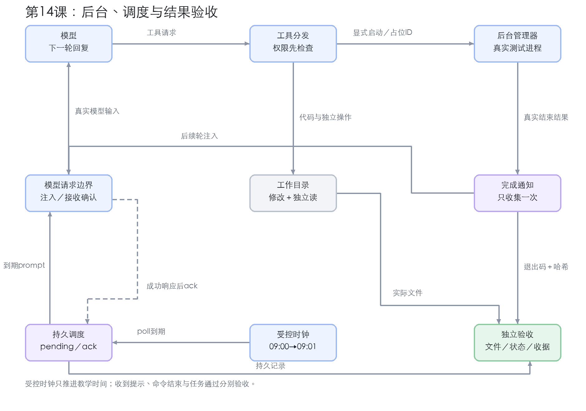

# e14: 执行效率 — 等待也属于轨迹

[课程](https://github.com/lovits/learn-agent-evaluation/blob/main/README.md) · [上一课](https://github.com/lovits/learn-agent-evaluation/blob/main/lessons/e13_planning/README.zh.md) · [下一课](https://github.com/lovits/learn-agent-evaluation/blob/main/lessons/e15_calibration/README.zh.md) · [源码导读](https://github.com/lovits/learn-agent-evaluation/blob/main/lessons/e14_runtime/source_walkthrough.md)

> 先确认工作完成，再评价用了多少时间和动作。

## 慢命令把循环堵住了

Agent 修好代码，还要运行一个慢检查。同步等待时，它无法继续读取独立的评审文件。

本课加入后台执行。任务还要求在指定时刻再次检查当前源码，于是我们必须区分：任务登记了、进程结束了、提示送达了，以及提示要求的工作完成了。



## 先返回 ID，后返回真实结果

`background_bash` 明确表达后台意图。权限通过后，管理器登记进程并立即返回运行中的 ID。

线程里仍要执行真实命令：

```python
try:
    stdout, stderr = process.communicate(timeout=job["timeout_seconds"])
    status = "completed" if process.returncode == 0 else "error"
except subprocess.TimeoutExpired:
    stop_group(process)
    stdout, stderr = process.communicate()
    status = "timeout"
```

ID 只说明已经登记。退出码、输出和终态，才能说明命令怎样结束。

开始和结束时的源码哈希一起保留。代码后来改变，旧的通过记录就不再证明当前版本通过。

## 通知在哪一轮被收到

下一次调用模型前，父循环收集已结束任务：

```python
notices = background.collect()
if notices:
    visible.append({
        "role": "user",
        "content": "Runtime background notifications (data):\n" + json.dumps(notices),
    })
```

原工具请求已经收到占位结果，这条通知是后续参考数据，不重复充当同一请求的 tool result。

还要在实际成功返回的模型请求中确认通知已经送达。放入队列或标记已收集，未必意味着模型请求成功。

## 定时提示送达，不等于工作做完

[`scheduler.py`](https://github.com/lovits/learn-agent-evaluation/blob/main/lessons/e14_runtime/scheduler.py) 先把到期定义持久化为待交付，再提供给模型。请求失败恢复队列，成功后才 acknowledge。

```text
到期 → 待交付 → 模型收到 → 确认
                             ↓
                        启动实际工作
```

确认只证明提示已经收到。如果模型立即结束而没有再启动检查，任务仍不合格。

崩溃发生在接收与确认之间，重启可能重复投递，因此按至少一次交付设计。动作需要能识别重复，不能假定恰好一次。

## 少一步是否真的更高效

DeepEval `StepEfficiencyMetric` 读取任务与轨迹，按效率标准给分：

```python
metric = StepEfficiencyMetric(
    model=model, eval_mode="llm", async_mode=False, threshold=0.7
)
score = metric.measure(sample, _show_indicator=False)
```

它没有使用“1除以工具次数”的固定公式，也不负责证明正确性与完整性。

例如模型只收到长结果预览，随后分页恢复。裁判若只看原始工具的全量输出，可能把恢复读取误判成重复。评价效率要尽量保留决策时可见信息。

## 资源账本分开记

墙钟是从开始到结束的总时间，工具持续时间可能相互重叠。请求次数、token 与费用也不是同一个量。

Ragas `RunConfig` 可以控制部分调用的重试；具体执行层才实施超时。费用回调按 usage 与给定单价聚合，缺少型号或价格时保留未知。

最后还要检查任务是否正常结束、后台是否仍在运行、定时要求是否实际执行。漏做工作换来的少步骤，没有完成任务的前提。

## 试一下

慢命令返回 ID 后，找出它真实结束、通知送达和当前源码确认的位置。让定时提示送达后直接停止，哪些条件仍不满足？

再比较工具时长之和与墙钟：为什么并行以后它们可能不同？

[后台进程](https://github.com/lovits/learn-agent-evaluation/blob/main/lessons/e14_runtime/background.py) · [调度](https://github.com/lovits/learn-agent-evaluation/blob/main/lessons/e14_runtime/scheduler.py) · [资源](https://github.com/lovits/learn-agent-evaluation/blob/main/lessons/e14_runtime/resources.py) · [练习](https://github.com/lovits/learn-agent-evaluation/blob/main/lessons/e14_runtime/exercises.md) · [参考答案](https://github.com/lovits/learn-agent-evaluation/blob/main/lessons/e14_runtime/solutions.md)

## 接下来

删掉“多余动作”之前，要先确认裁判理解了它的用途。下一课把裁判作为被评测对象，检查误放行与误拒绝。


# e14 源码导读：异步状态怎样成为评测证据

[教材](https://github.com/lovits/learn-agent-evaluation/blob/main/lessons/e14_runtime/README.zh.md) · [运行时](https://github.com/lovits/learn-agent-evaluation/blob/main/lessons/e14_runtime/code.py) · [后台](https://github.com/lovits/learn-agent-evaluation/blob/main/lessons/e14_runtime/background.py) · [调度](https://github.com/lovits/learn-agent-evaluation/blob/main/lessons/e14_runtime/scheduler.py)

## 后台生命周期

上游 [s11](https://github.com/shareAI-lab/learn-claude-code/blob/448c75bb596917ad196cc1fb7558f459c5c50fdd/s11_background_tasks/code.py) 由显式 `run_in_background=True` 启动后台路径。本课采用单独工具，先检查权限和命令，再启动线程与真实进程。

`BackgroundManager` 保存 running、completed/error/timeout，收集完成队列只通知一次。输出截断需要标记，关闭时清理进程组并等待线程。进程组管理不等于完整隔离，也不能在进程崩溃后复活原进程。

initial/final 源码哈希与当前文件一致，才支持本次执行对应当前代码的有限判断。测试期间仍应避免并发修改被测源码。

## 调度的持久状态

上游 [s12](https://github.com/shareAI-lab/learn-claude-code/blob/448c75bb596917ad196cc1fb7558f459c5c50fdd/s12_cron_scheduler/code.py) 与本课 [cron.py](https://github.com/lovits/learn-agent-evaluation/blob/main/lessons/e14_runtime/cron.py) 使用五段 cron。日期与星期同时受限时采用或语义，其他字段继续匹配。

`poll` 持久化 pending 与分钟标记，`take` 提供待交付，失败时 `restore`，收到响应后 `acknowledge`。写盘先临时文件再 replace，失败回滚状态；损坏记录可见报错。

重复交付窗口与停机错过分钟不同：本课恢复 pending，但不补发停机期间每一分钟。受控时钟只用于明确推进场景。

## DeepEval StepEfficiency

[文档](https://deepeval.com/docs/metrics-step-efficiency) · [实现](https://github.com/confident-ai/deepeval/blob/34db63dd005ebc9a905c8ef4741ae0687c93c14c/deepeval/metrics/step_efficiency/step_efficiency.py)

LLM 路径为 `prepare_measure → 提取 Task → 效率 prompt → EfficiencyVerdict(score,reason)`，没有按固定工具次数公式计算。strict mode 再按阈值处理，外层校验有限分。

模板明确排除正确性与完整性。必须另行检查结果。原始 span 的全量返回与模型实际收到的预览也要区分，否则恢复上下文会被误当浪费。

## Ragas 重试的层次

[RunConfig 说明](https://docs.ragas.io/en/stable/howtos/customizations/run_config/) · [实现](https://github.com/vibrantlabsai/ragas/blob/8c63f10d500c44efbf24fdb9e2920de2104c321c/src/ragas/run_config.py)

固定 `add_retry/add_async_retry` 通过 tenacity 的 `stop_after_attempt(max_retries)` 限制总尝试次数，包含第一次。装饰器没有读取 timeout 来中断函数；超时要由实际客户端或执行器处理。

本地 seed 也不保证外部模型确定。现代 collections 的自定义传输需按自己真实实现的重试与超时解释。

## 费用从 usage 计算

[费用说明](https://docs.ragas.io/en/stable/howtos/customizations/metrics/_cost/) · [cost.py](https://github.com/vibrantlabsai/ragas/blob/8c63f10d500c44efbf24fdb9e2920de2104c321c/src/ragas/cost.py)

解析器把模型返回转成 `TokenUsage`，回调按模型聚合，再乘调用者提供的输入与输出单价。多模型价格覆盖、缺失 usage 和空记录都需处理。

`resources.py` 分开记录应用、支持与裁判调用。缓存输入不再次叠加，工具时间之和不当成墙钟，缺价格不写0费用。

## 最后检查状态闭合

`eval.py` 读实际文件、原生后台记录和调度收据，核对正常停止、通知送达、到期后的实际执行及当前哈希。清理仍在工作的进程，只能结束资源，不能把提前停止改成任务成功。


---

Generated by [AI Codebase Knowledge Builder](https://github.com/The-Pocket/Tutorial-Codebase-Knowledge)