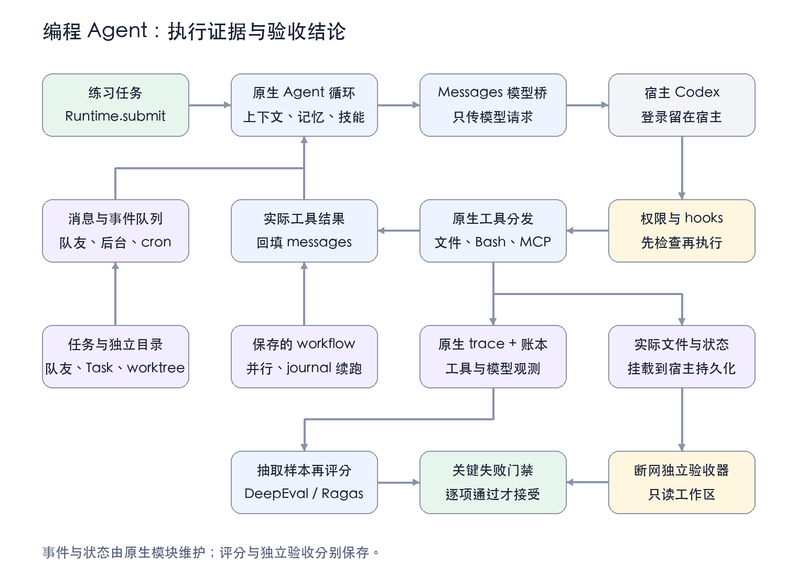

# e16: 持续回归 — 把评测接回完整 Agent

[课程](https://github.com/lovits/learn-agent-evaluation/blob/main/README.md) · [上一课](https://github.com/lovits/learn-agent-evaluation/blob/main/lessons/e15_calibration/README.zh.md) · [源码导读](https://github.com/lovits/learn-agent-evaluation/blob/main/lessons/e16_regression/source_walkthrough.md)

> 从真实运行取样，让关键条件决定能否接受改动。

## 现在把这些部分接起来

前面分别看过检索、回答、工具和状态。完整 Agent 会把它们混在一次任务里：查知识库、改代码、委派检查、等后台结果，再报告完成。

本课把它们接成一条评测链。核心问题是：评分器拿到的样本，能否追溯到真正发生的动作？



## 一次任务从同一个入口进入

综合项目的 [`Runtime.submit`](https://github.com/lovits/learn-agent-evaluation/blob/main/integrated_agent/runtime.py) 把请求写入历史，再调用接入目标审查的原生循环：

```python
self.history.append({"role": "user", "content": query})
self.host.agent_loop(self.history, self.context, query)
return self.snapshot()
```

工具在工作区运行，知识库只读挂载。计划、子任务、记忆、后台和调度沿已学机制进入同一运行时；目标判断在返回边界决定继续或停止。

模型仍负责选择动作。组合场景中的阶段安排与明确批准由场景脚本承担，二者在轨迹里分别标明。

## 工作流恢复的是哪一步

可信评审脚本先并行看接口合同与测试覆盖，再核验候选意见：

```python
candidates = await ctx.parallel([
    lambda: inspect("API-contract"),
    lambda: inspect("test-coverage"),
])
```

每个成功步骤把输入与结果写进 journal。恢复时，用步骤名、提示和 schema 的语义键匹配已有结果。

命中缓存说明复用成功记录，不能证明旧意见正确。评审只看到实现文件时，也不能据此断言整个项目没有测试。

## 轨迹先保留实际参数与输出

请求账本保存真正发出的消息和模型响应；原生 trace 保存调用关系。通过响应 ID 找到对应 trace，再按时间提取工具 span：

```python
message_id = worker["response"]["id"]
tools = sorted(trace.get("toolSpans", []), key=lambda s: s["startTime"])
```

样本保留来源 UUID、工具名、参数与输出。只留一个 `OK`，无法判断它来自执行测试，还是打印文字；命令本身也是证据。

同步调用保留真实父子关系，队友线程产生独立根时保持独立，不补造调用树。

## 同一回答可以有不同证据范围

“原测试已通过”不能从“必须保留原测试”的规范推出。它需要实际执行记录。

因此 Faithfulness 样本分别用规范文档和观察到的工具行为作证据。证据范围不同，回答不变也可能获得不同裁决。这个差异不能归因于 Agent 能力变化。

工具指标则使用明确的局部投影，例如指定的两次文件读取。它诊断这部分轨迹，不代表所有任务只有唯一调用顺序。

## 最后接到关键条件

评分分开保存。业务行为、权限和必需状态先按规则检查，回答与轨迹再交给相应语义指标。

[`critical_gate`](https://github.com/lovits/learn-agent-evaluation/blob/main/lessons/e16_regression/code.py) 逐项接受严格为真的条件：

```python
rejected = [
    name for name, passed in checks.items()
    if passed is not True
]
```

任一必需项为假或未知，都阻止接受改动，不能靠其他高分平均掉。逐样本分数帮助定位，门禁执行已经声明的接受政策。

将查明的失败加入固定回归：缺少调用、未提供测试上下文、空裁决、权限拒绝或未完成状态。CI 可以反复检查这些确定条件，模型评价另按固定数据与配置执行。

## 试一下

从一次完整运行找出：响应 ID、对应工具 span、文件状态和原生指标输入。删掉其中一个工具读取的样本副本，说明哪些分数会改变，原 Agent 有没有发生变化。

再将一个关键条件设为未知，检查门禁为何必须保留拒绝原因。

[综合项目](https://github.com/lovits/learn-agent-evaluation/blob/main/integrated_agent/README.md) · [采样与门禁](https://github.com/lovits/learn-agent-evaluation/blob/main/lessons/e16_regression/code.py) · [双框架评分](https://github.com/lovits/learn-agent-evaluation/blob/main/lessons/e16_regression/eval.py) · [练习](https://github.com/lovits/learn-agent-evaluation/blob/main/lessons/e16_regression/exercises.md) · [参考答案](https://github.com/lovits/learn-agent-evaluation/blob/main/lessons/e16_regression/solutions.md)

## 用到自己的项目

先定义自己的任务与成功条件，准备带版本的知识库和数据，再保存实际执行轨迹。选指标时明确比较对象、方向、分母和空值约定；发现失败以后，把能够独立确认的条件加入回归。

到这里，模型输出、运行证据、评分结果与接受政策已经各有位置。你可以沿这条链解释一次具体失败，也可以用相同任务比较下一版 Agent。


# e16 源码导读：证据怎样走到门禁

[教材](https://github.com/lovits/learn-agent-evaluation/blob/main/lessons/e16_regression/README.zh.md) · [综合运行时](https://github.com/lovits/learn-agent-evaluation/blob/main/integrated_agent/runtime.py) · [采样](https://github.com/lovits/learn-agent-evaluation/blob/main/lessons/e16_regression/code.py) · [评分](https://github.com/lovits/learn-agent-evaluation/blob/main/lessons/e16_regression/eval.py)

## 从公开入口追到模型与工具

```text
Runtime.submit → _goal_loop → 原生 agent_loop
                                  ├─ RecordedMessages.create
                                  └─ PreToolUse → handler → PostToolUse
                                                           ↓
                                                     tool_result
```

固定 [s15 集成](https://github.com/shareAI-lab/learn-claude-code/blob/448c75bb596917ad196cc1fb7558f459c5c50fdd/s15_integrated_harness/code.py)、[s09 记忆](https://github.com/shareAI-lab/learn-claude-code/blob/448c75bb596917ad196cc1fb7558f459c5c50fdd/s09_memory/code.py)、[s16 工作流](https://github.com/shareAI-lab/learn-claude-code/blob/448c75bb596917ad196cc1fb7558f459c5c50fdd/s16_workflow_runtime/code.py)与 [s17 目标](https://github.com/shareAI-lab/learn-claude-code/blob/448c75bb596917ad196cc1fb7558f459c5c50fdd/s17_goal_loop/code.py)在适配层接线，上游副本保留来源与许可。

`returned` 只表示入口返回。Goal 读取对话证据，独立检查器再读业务文件与持久状态。

## 原生观测与样本投影

`traces.py` 在固定版本 trace 结束边界保存原生对象。观测对象限定在实际调用边界，避免把整套运行时的公开对象图作为普通输入序列化。

`trace_samples` 用原生响应 ID 连接唯一 trace，保留工具名、参数、输出、时间与 UUID。函数正常返回的 `SUCCESS` 可能包含错误字符串，要继续读结果内容。

规范证据与工具观测分别构造 Faithfulness 样本；工具样本是指定读取的局部投影。原始记录不因投影而被替换。

## DeepEval 与 Ragas 怎样复用

[DeepEval Faithfulness](https://github.com/confident-ai/deepeval/blob/34db63dd005ebc9a905c8ef4741ae0687c93c14c/deepeval/metrics/faithfulness/faithfulness.py)继续走 truths、claims、verdict 与 [QAG 聚合](https://github.com/confident-ai/deepeval/blob/34db63dd005ebc9a905c8ef4741ae0687c93c14c/deepeval/metrics/utils/qag.py)。默认接受 yes/borderline，惩罚含糊项只接受 yes。空裁决默认1，需要同时保留声明数。

[Ragas Faithfulness](https://github.com/vibrantlabsai/ragas/blob/8c63f10d500c44efbf24fdb9e2920de2104c321c/src/ragas/metrics/collections/faithfulness/metric.py)走 statements、NLI、支持比例；无声明可返回 NaN，外层记录未定义。详情见[第5课源码导读](https://github.com/lovits/learn-agent-evaluation/blob/main/lessons/e05_faithfulness/source_walkthrough.md)。

[DeepEval ToolCorrectness](https://github.com/confident-ai/deepeval/blob/34db63dd005ebc9a905c8ef4741ae0687c93c14c/deepeval/metrics/tool_correctness/tool_correctness.py)按配置评价覆盖、参数、顺序或完整匹配；[Ragas Accuracy](https://github.com/vibrantlabsai/ragas/blob/8c63f10d500c44efbf24fdb9e2920de2104c321c/src/ragas/metrics/collections/tool_call_accuracy/metric.py)先对齐调用序列，[F1](https://github.com/vibrantlabsai/ragas/blob/8c63f10d500c44efbf24fdb9e2920de2104c321c/src/ragas/metrics/collections/tool_call_f1/metric.py)另算集合覆盖。两个预期调用只完成一个时，可以分别得到覆盖1/2、完整匹配0与集合F1为2/3。

这些是不同判分合同，不能平均同名分数来代替解释。

## 工作流为什么能恢复

`workflows.py` 安装可信脚本。`ExecutionState.agent` 先检查请求与预算，再按步骤、prompt 与 schema 查日志；命中结果仍经过 schema 校验。

`parallel` 等已经启动的分支结束后再抛错误，使成功分支可以写完 journal。恢复复用这些步骤；日志损坏时保留错误，不假装重新成功。

工作流完成与评审意见正确分别检查。`gates.py` 在已知测试文件不在输入范围时，拒绝接受项目级覆盖结论。

## 独立状态检查与回归入口

`verify.py` 运行有限业务合同，`state.py` 读取实际 Task、记忆索引、cron、worktree 与 workflow 日志。模型总结和团队摘要只作为可追查声明。

`critical_gate` 对每个关键值使用 `is True`，把假、未知和未评分都保留为拒绝项。通过比例可用于诊断，关键条件仍逐项处理。

[DeepEval evaluate](https://github.com/confident-ai/deepeval/blob/34db63dd005ebc9a905c8ef4741ae0687c93c14c/deepeval/evaluate/evaluate.py) 与 [Ragas evaluation](https://github.com/vibrantlabsai/ragas/blob/8c63f10d500c44efbf24fdb9e2920de2104c321c/src/ragas/evaluation.py)提供批量入口；本课直接调用 metric 以保留中间阶段，不混用旧批量 API 与 collections 签名。

回归思路见 [DeepEval CI 指南](https://deepeval.com/guides/guides-regression-testing-in-cicd)与 [Ragas CI 指南](https://docs.ragas.io/en/stable/howtos/applications/add_to_ci/)。固定规则检查与真实模型评价分别运行，后者还需数据、裁判与配置版本。


---

Generated by [AI Codebase Knowledge Builder](https://github.com/The-Pocket/Tutorial-Codebase-Knowledge)