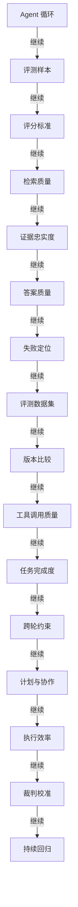

# Tutorial: course

从编程 Agent 学评测

**Source Repository:** [None](None)

## Chapters

1. [Agent 循环](01_agent_循环.md)
2. [评测样本](02_评测样本.md)
3. [评分标准](03_评分标准.md)
4. [检索质量](04_检索质量.md)
5. [证据忠实度](05_证据忠实度.md)
6. [答案质量](06_答案质量.md)
7. [失败定位](07_失败定位.md)
8. [评测数据集](08_评测数据集.md)
9. [版本比较](09_版本比较.md)
10. [工具调用质量](10_工具调用质量.md)
11. [任务完成度](11_任务完成度.md)
12. [跨轮约束](12_跨轮约束.md)
13. [计划与协作](13_计划与协作.md)
14. [执行效率](14_执行效率.md)
15. [裁判校准](15_裁判校准.md)
16. [持续回归](16_持续回归.md)

---

Generated by [AI Codebase Knowledge Builder](https://github.com/The-Pocket/Tutorial-Codebase-Knowledge)