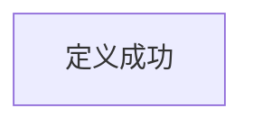

# Tutorial: course

从编程 Agent 学评测

**Source Repository:** [https://github.com/lovits/learn-agent-evaluation](https://github.com/lovits/learn-agent-evaluation)

## Chapters

1. [定义成功](01_定义成功.md)

---

Generated by [AI Codebase Knowledge Builder](https://github.com/The-Pocket/Tutorial-Codebase-Knowledge)