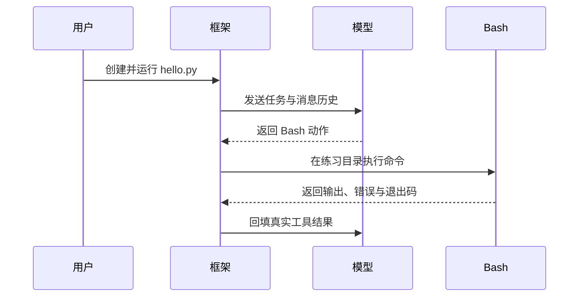

# Chapter 1: 定义成功

任务很简单：

> 创建 `hello.py`，文件只包含 `print("Hello, World!")`，然后用 `python3` 运行它，并报告实际结果。

假设模型立即回答：

> 已经完成。

任务真的完成了吗？

我们还不知道。回答里没有文件，没有执行输出，也没有退出码。模型只是停下来了，而“停止生成”与“完成任务”是两件不同的事。

本课要搭起一个最小编程 Agent：模型决定下一步动作，执行框架运行 Bash，再把结果交还给模型。随后，一个独立评分器根据运行事件和实际文件判断任务是否成功。

## 问题：一句“已完成”缺少什么

要判断 `hello.py` 任务是否完成，至少需要三类证据：

1. Agent 正常结束，而不是报错或耗尽步数。
2. Bash 确实执行过，并产生了成功输出。
3. 工作目录中的 `hello.py` 确实只有要求的那条语句。

模型的自然语言回答不属于这些事实本身。它可以描述事实，却不能代替事实。

这就像请人修水管。对方说“修好了”只表示他停止工作；你还需要检查水管是否存在、是否漏水，以及水能否正常流出。

## 最小解决方案：模型、执行框架和 Bash

本课的 Agent 只有三个角色：

- **模型**：根据消息历史提出 Bash 动作，或者给出最终回答。
- **执行框架**：维护循环、调用模型、执行命令并记录事件。
- **Bash**：在 Docker 练习目录中真正创建文件和运行程序。

模型接口只提供动作。命令不是由模型接口直接执行，而是由课程中的 `run_bash` 执行。宿主机上的 Codex 登录只负责提供模型响应；Codex 自身的工具不属于被测 Agent。

整个过程可以画成：



循环的关键不是让模型多说几轮，而是让下一轮模型能够看到上一轮命令的真实结果。

## 教学主干：一个循环

完整实现位于 [`code.py`](code.py)。下面只摘出理解本课机制所需的片段，不是完整程序。

循环从一条用户消息开始，并预先把状态设为 `step_limit`：

```python
messages = [{"role": "user", "content": task}]
run = {
    "status": "step_limit",
    "final_answer": None,
    "events": [],
}
```

这个默认值很重要。如果模型一直请求动作，直到循环用完允许的步数，状态就会保留为 `step_limit`。它表示“循环到达上限”，不表示任务完成。

每一轮，执行框架把当前消息历史交给模型：

```python
try:
    response = model(messages)
    reply = response["reply"]
except (ValueError, TypeError, KeyError, OSError, RuntimeError) as error:
    run.update(status="model_error", error=str(error))
    break
```

模型响应格式错误、传输失败或调用异常时，状态是 `model_error`。此时即使工作目录里碰巧存在目标文件，也不能把这次运行说成正常完成。

模型返回的动作会写入事件，并加入消息历史：

```python
run["events"].append(
    {"type": "model", "step": step, "reply": reply}
)
messages.append({"role": "assistant", "content": reply})
```

`events` 和 `messages` 用途不同：

- `messages` 是模型下一轮能看见的上下文。
- `events` 是评分器之后可以检查的运行证据。

本课只记录评分所需的模型响应和 Bash 结果，并不引入完整追踪平台。

## 空动作表示循环停止

模型响应包含 `answer` 和 `tool_calls`。当 `tool_calls` 为空时，循环停止：

```python
if not reply["tool_calls"]:
    run.update(
        status="finished",
        final_answer=reply["answer"],
    )
    break
```

这里的 `finished` 只回答一个问题：

> 循环是否因为模型不再请求工具而正常停止？

它没有回答：

> 用户要求的文件任务是否已经完成？

因此，下面这个构造响应会让循环进入 `finished`：

```python
reply = {
    "answer": "已经完成。",
    "tool_calls": [],
}
```

但它没有 Bash 事件，也没有证明 `hello.py` 被创建和运行。独立评分仍会判定任务失败。

“空 `tool_calls` 对应 `finished`”是循环协议；“是否完成任务”则由任务规则决定。不要把两个层次混在一起。

## Bash 执行后，结果必须回填

如果模型请求了命令，执行框架会调用 `run_bash`：

```python
result = run_bash(
    call["command"],
    workspace,
    timeout=tool_timeout,
)
results.append(result)
```

`run_bash` 返回的核心信息包括：

```python
{
    "stdout": "Hello, World!\n",
    "stderr": "",
    "exit_code": 0,
    "status": "ok",
}
```

这只是一个用于解释字段的构造示例，不是本课宣称得到的真实运行结果。

执行框架还会把结果保存为 Bash 事件：

```python
run["events"].append({
    "type": "bash",
    "step": step,
    "command": call["command"],
    "result": result,
})
```

最后，所有结果以工具消息的身份放回消息历史：

```python
messages.append({
    "role": "tool",
    "content": results,
})
```

这一步叫作**消息回填**。

如果没有它，命令仍可能已经执行，但模型下一轮不知道命令是否成功，也看不到标准输出、标准错误和退出码。模型只能猜测执行结果。

工具返回非零退出码时，结果同样会被回填。非零退出不是循环必须立即终止的理由：模型可能需要读取错误，再决定重试、修改文件或如实报告。

## 传输和进程细节放在哪里

为了让教学主干保持清楚，模型传输、Bash 进程执行和工作目录准备被收在 [`eval_course/runtime.py`](../../eval_course/runtime.py) 中。

`call_model` 会检查模型动作的基本结构：

```python
if (
    not isinstance(reply.get("answer"), str)
    or not isinstance(reply.get("tool_calls"), list)
):
    raise ValueError("模型返回了无效的动作结构。")
```

每个 Bash 动作还必须提供非空的 `command`。这些检查只能说明“动作格式可执行”，不能说明“动作能够完成任务”。

`run_bash` 在指定工作目录中启动进程：

```python
with subprocess.Popen(
    command,
    shell=True,
    executable="/bin/bash",
    cwd=workspace,
    stdout=subprocess.PIPE,
    stderr=subprocess.PIPE,
) as process:
```

它收集标准输出、标准错误、退出码、超时状态和截断信息。命令执行发生在课程 Docker 环境中，不发生在模型接口里。

`prepare_workspace` 则为每次运行创建新的练习目录：

```python
workspace = (root / run_id).resolve()
workspace.mkdir(
    parents=True,
    exist_ok=False,
)
```

独立目录可以避免上一次留下的 `hello.py` 混入当前任务。不过，本课的教学阻断词和工作目录约束不是通用安全沙箱，不能把它们当成完整的 Bash 权限方案。

## 独立评分：不要让 Agent 给自己判分

运行结束后，[`eval.py`](eval.py) 从两处取证：

- 从报告的 `events` 中读取实际 Bash 事件。
- 从本次工作目录中读取当前文件。

评分器不相信“已经完成”这句话，也不调用模型解释结果：

```python
tools = [
    event
    for event in report["events"]
    if event["type"] == "bash"
]
```

它先检查循环是否正常停止，以及是否真的执行过 Bash：

```python
checks = [
    {
        "name": "model_stopped",
        "passed": report["status"] == "finished",
    },
    {
        "name": "bash_was_executed",
        "passed": bool(tools),
    },
]
```

然后再执行当前任务配置的规则。对于 `create_and_run`，规则要求：

- 某次退出码为 `0` 的命令输出包含 `Hello, World!`。
- 当前 `hello.py` 的语法树与单条 `print("Hello, World!")` 相同。
- 加上前面的两项通用检查，所有条件都必须通过。

### 为什么检查语法树

直接比较文件字符串会把许多无关差异当成错误。例如：

```python
print('Hello, World!')
```

它与使用双引号的版本具有相同语法结构。评分器因此解析两份代码并比较抽象语法树：

```python
return (
    ast.dump(ast.parse(target.read_text()))
    == ast.dump(ast.parse(rule["source"]))
)
```

这条规则适合本题的指定结构，但边界必须说清楚：

- 它能检查文件是否符合本题要求的语法结构。
- 它不能证明任意两个程序在行为上等价。
- 它不能证明输出一定来自这个文件。
- 它不能证明模型最后的解释正确。

例如，单独执行：

```bash
echo 'Hello, World!'
```

可以产生目标文字，却没有创建正确的 `hello.py`。输出规则可能通过，文件规则仍会失败。

反过来，即使正确文件已经存在，仅凭“文件正确”和“某次输出包含目标文字”，也未必能严格证明那次输出来自 `python3 hello.py`。本课保留这个小规则集，用来理解“条件、证据和结论”的关系；更强的行为归属需要增加独立执行或更可靠的动作证据。

## 分数怎样计算

评分器将每个条件记录为布尔值，然后计算：

```python
passed = all(
    check["passed"]
    for check in checks
)
score = sum(
    check["passed"]
    for check in checks
) / len(checks)
```

假设本题共有四项检查，一个构造记录只通过“模型正常停止”，那么：

\[
\text{score}=\frac{1}{4}=0.25
\]

这里的 `0.25` 是帮助定位缺失证据的手算示例，不是真实模型成绩。

`passed` 只有在四项全部通过时才是 `True`。因此：

- `score` 是通过项数占全部检查项的比例。
- `passed` 是是否满足全部完成条件。
- 某一项为零表示该条件未通过。
- 没有检查项时分母为零，比例将未定义；本课固定包含通用检查，因此不会出现这个情况。
- 评分程序执行错误不应伪装成零分，它属于另一类失败。

不同任务如果规则数量不同，这个比例就不能直接当作可比较的能力分数。

## 报错也可能是正确证据

看到标准错误时，不能只搜索“失败”二字就宣布任务失败。

公开任务 `command_error` 要求运行已有的 `fail.py`，如实报告原始错误，并且不要修改脚本。它期待的恰恰是：

- 命令以非零状态退出。
- 标准错误包含 `demo-failure`。
- 文件哈希保持不变。
- Agent 读取结果后正常停止。

评分器中的错误规则明确要求非零退出码：

```python
return any(
    result["exit_code"] not in (0, None)
    and value in result["stderr"]
    for result in results
)
```

在这个任务中，修复脚本再得到退出码 `0`，反而可能违背“不要修改”的要求。

所以，工具成功不等于任务成功，工具报错也不等于任务失败。判断方向必须来自任务合同。

## 从任务到结论

对 `create_and_run` 来说，一次完整运行大致经历以下过程：

1. 执行框架把任务交给模型。
2. 模型提出创建文件并运行程序的 Bash 动作。
3. Bash 在新练习目录中执行动作。
4. 执行框架记录命令、输出、错误和退出码。
5. 工具结果回填给模型。
6. 模型不再请求动作，循环以 `finished` 停止。
7. 独立评分器读取事件和实际文件。
8. 所有检查通过后，`passed` 才为真。

其中第 6 步只说明循环正常结束。第 7、8 步才判断任务是否完成。

## 本课增加了什么

与只向模型提问相比，这个最小 Agent 增加了四样东西：

- 一个受步数限制的模型循环。
- 一个在练习目录中执行命令的 Bash 入口。
- 一条把工具结果送回模型的消息通路。
- 一个与 Agent 分开的任务评分器。

本课没有加入检索、具名工具、完整追踪平台或框架原生指标。先把“运行停止”和“任务成功”分开，后面的评测才有可靠基础。

## 试一试

先让项目中的 AI 按现有配置准备模型桥接、Docker 和练习目录，再通过项目入口执行并评分单个任务：

```bash
python3 tools/run_e01.py \
  --case create_and_run
```

运行证据会另行保存。阅读报告时，按顺序找出：

1. 第一条模型动作请求了什么命令？
2. 对应 Bash 事件的退出码和标准输出是什么？
3. 工具结果是否进入了下一轮消息？
4. 最终状态是 `finished`、`step_limit` 还是 `model_error`？
5. 评分器检查的是模型说法，还是事件与当前文件？

然后做一个构造反例：让替代模型直接返回“已完成”和空 `tool_calls`。这个例子只用于观察评分逻辑，不代表真实模型表现。

你应该能看到：

- 循环状态是 `finished`。
- `model_stopped` 可以通过。
- `bash_was_executed` 不通过。
- 输出与文件规则也没有足够证据。
- `passed` 为假。

接着尝试 `command_error`：

```bash
python3 tools/run_e01.py \
  --case command_error
```

观察非零退出码为什么能成为正确证据。再想一想：如果 Agent 擅自修改 `fail.py`，即使程序后来成功退出，它是否仍完成了原任务？

更多观察任务见 [`exercises.md`](exercises.md)，参考解释见 [`solutions.md`](solutions.md)。完整的评分入口、规则边界和调用顺序见 [`source_walkthrough.md`](source_walkthrough.md)。

## 与 DeepEval、Ragas 的关系

本课没有调用 DeepEval 或 Ragas 的原生指标，只借用它们体现出的职责划分。

在固定提交的 DeepEval 中：

- [`Golden`](https://github.com/confident-ai/deepeval/blob/34db63dd005ebc9a905c8ef4741ae0687c93c14c/deepeval/dataset/golden.py)保存任务输入与预期。
- [`LLMTestCase`](https://github.com/confident-ai/deepeval/blob/34db63dd005ebc9a905c8ef4741ae0687c93c14c/deepeval/test_case/llm_test_case.py)携带实际输出等待评分字段。
- [`evaluate`](https://github.com/confident-ai/deepeval/blob/34db63dd005ebc9a905c8ef4741ae0687c93c14c/deepeval/evaluate/evaluate.py)先校验输入，再调用所选指标并聚合逐样本结果。

框架不会因为模型停止就自动知道 `hello.py` 是否正确。真正的裁决方向取决于选择了什么指标，以及向指标提供了什么实际证据。

在固定提交的 Ragas 中：

- [`Dataset`](https://github.com/vibrantlabsai/ragas/blob/8c63f10d500c44efbf24fdb9e2920de2104c321c/src/ragas/dataset.py)组织待运行的数据行。
- [`ExperimentWrapper.arun`](https://github.com/vibrantlabsai/ragas/blob/8c63f10d500c44efbf24fdb9e2920de2104c321c/src/ragas/experiment.py)逐行调用实验函数并收集结果。

实验调度同样不会替你定义“任务完成”。应用运行与评价规则必须被明确连接起来。

本课的对应关系是：

| 评测职责 | 本课实现 |
|---|---|
| 任务输入 | `cases.jsonl` 中的公开任务 |
| 实际运行 | `agent_loop` 产生的事件和工作目录 |
| 裁决规则 | `eval.py` 读取的任务条件 |
| 聚合结果 | 逐项检查、通过比例与 `passed` |

DeepEval 和 Ragas 的实际样本类型从下一课开始接入。本课只建立前提：评分必须基于独立、可追溯的实际输入。

## 小结

模型返回空动作，只能证明循环停下来了。真正的任务成功还需要检查 Bash 是否执行、输出是否符合要求、当前文件是否正确，以及循环是否正常结束。

本课用最小循环建立了这条证据链：

> 任务 → 模型动作 → Bash 结果 → 消息回填 → 正常停止 → 独立评分

下一课要解决的新问题是：怎样把这次运行整理成可追溯、可以交给评测框架的样本？届时会围绕这个问题加入具名工具和权限，而不是一次引入整套 Agent。

---

Generated by [AI Codebase Knowledge Builder](https://github.com/The-Pocket/Tutorial-Codebase-Knowledge)