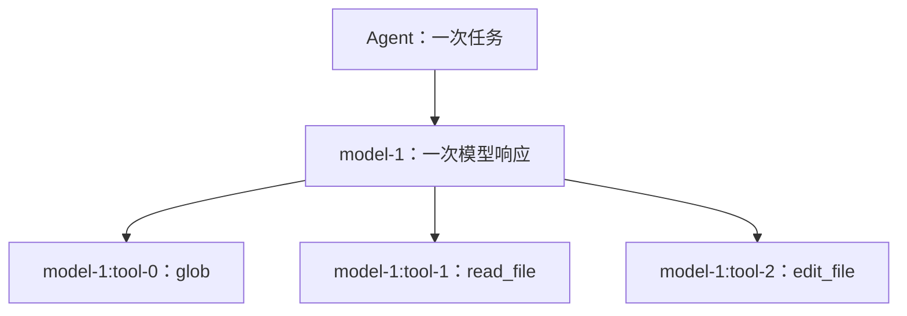

# Chapter 1: 工具、权限、轨迹与统一评测样本

## 问题

第1课里，我们已经让模型提出 Bash 动作，并复用了两个函数：

- `prepare_workspace`：为每次实验准备独立工作目录；
- `run_bash`：在工作目录中执行命令，保留 `stdout`、`stderr`、`exit_code` 和超时状态。

这一课继续处理同一个具体任务。工作目录里有一个 `calculate.py`：

```python
print(6 * 7)
```

我们希望 Agent 找到这个文件，把 `6 * 7` 改成 `6 * 8`，运行程序，再把实际输出写入 `result.txt`。完成后应当得到：

```text
48
```

只用 Bash 当然也能完成，例如调用 `sed`、`python3` 和重定向。但这样留下的记录只是一串命令。评测程序很难直接回答：模型是否先读了文件？修改的是哪一处？写文件和执行程序分别成功了吗？

因此，本课给动作加上名字，提供五种工具：

| 工具 | 必需参数 | 用途 |
|---|---|---|
| `bash` | `command` | 执行命令 |
| `read_file` | `path` | 读取文本文件 |
| `write_file` | `path`、`content` | 写入文本文件 |
| `edit_file` | `path`、`old_text`、`new_text` | 替换第一处匹配文本 |
| `glob` | `pattern` | 按模式查找文件，最多返回200项 |

具名工具不是为了消灭 Bash。运行 `python3 calculate.py` 仍适合交给 Bash；寻找、读取、修改和写入文件则使用参数清楚的文件工具。这样，验收器可以分别检查工具选择、权限结论、执行结果和最终文件。

工具一多，还会出现两个新问题。第一，某些动作不应直接执行，例如读取工作目录外的 `/etc/hostname`。第二，同一轮可能连续调用两次 `read_file`，仅凭工具名无法知道哪个返回值属于哪个请求。我们需要在执行前判断权限，并为每次调用分配唯一的关联标识。

完整实现见 [code.py](code.py)，五条任务见 [cases.jsonl](cases.jsonl)。

## 解决方案

本课把一次动作拆成四层：

```text
模型给出调用
    → 参数校验
    → 权限判断
    → 工具执行
    → 记录结果
```

例如，修改 `calculate.py` 的调用不是一段含糊文字，而是一个名字和一组 JSON 参数：

```json
{
  "name": "edit_file",
  "arguments_json": "{\"path\":\"calculate.py\",\"old_text\":\"6 * 7\",\"new_text\":\"6 * 8\"}"
}
```

运行时先检查三个必需参数是否齐全、是否都是字符串。随后解析路径，确认它仍在本次工作目录内。只有参数和权限都通过，才会真正读取并改写文件。

每次工具调用还会生成 `call_id`。假设第二次模型响应提出了三个动作，它们依次是：

```text
model-2:tool-0
model-2:tool-1
model-2:tool-2
```

这些标识同时出现在工具事件和返回给模型的结果中。即使前两个动作都叫 `read_file`，也不会因为名字重复而配错。

轨迹采用一棵简单的父子树：



最外层实验另有一个随机生成的 `run_id`。它区分不同运行；`agent`、`model-N` 和 `model-N:tool-i` 则描述同一次运行内部的层级。换句话说，`run_id` 先找到哪次实验，`parent_id` 和 `span_id` 再找到动作属于哪次模型响应。

执行前后的 hook 也写入报告：

- `UserPromptSubmit`：任务提交；
- `PreToolUse`：工具处理开始；
- `PostToolUse`：工具处理结束；
- `Stop`：Agent 停止。

本课的 `PreToolUse` 和 `PostToolUse` 覆盖所有工具请求，包括权限拒绝和参数错误。这里记录的是本地教学轨迹，并没有接入 DeepEval 原生云端 tracing。

## 工作原理

下面沿着“把42改成48”这条数据流读代码。片段均有省略，用来说明接入点，不能单独作为程序入口运行。

**第1步：声明工具及必需参数**

运行时需要先知道每个工具接受哪些参数：

```python
TOOL_SPEC = {
    "bash": {"command": "str"},
    "read_file": {"path": "str"},
    "write_file": {"path": "str", "content": "str"},
    "edit_file": {"path": "str", "old_text": "str", "new_text": "str"},
    "glob": {"pattern": "str"},
}
```

`validate_call` 解析 `arguments_json`，要求参数集合与声明完全一致，并要求所有值都是字符串。假如 `read_file` 收到 `{}`，它不会进入权限检查或文件读取，而是在执行前返回：

```json
{
  "status": "invalid_arguments",
  "output": "Expected arguments: path"
}
```

`None`、漏参和多传参数都不能悄悄混过去。这样可以把“模型没有按工具契约传参”和“文件执行失败”分开。

**第2步：由 dispatch 分发到本地实现**

本课的本地 `execute` 按工具名使用条件分支：

```python
if name == "bash":
    return run_bash(args["command"], workspace)
if name == "glob":
    paths = sorted(workspace.glob(args["pattern"]))
    return {"status": "ok", "output": "\n".join(paths[:200])}
```

文件工具也在同一个函数中分支处理。`edit_file` 最关键的一行是：

```python
updated = text.replace(args["old_text"], args["new_text"], 1)
```

末尾的 `1` 表示只替换第一处。若 `old_text` 为空或根本不存在，工具抛出 `ValueError`，原文件不会被写入。`glob` 先排序，再截取前200项，避免一次结果无限增长。

这里不要把上游课程的实现方式误认为本课实现。原版 s02 使用 `TOOL_HANDLERS` 查表；本课的 `execute` 是按 `name` 判断。两者的源码对应关系放在 [源码导读](source_walkthrough.md)。

**第3步：执行前检查 permission**

文件路径在真正访问前解析：

```python
path = (workspace / args["path"]).resolve()
if not path.is_relative_to(workspace):
    return "deny", "outside_workspace"
return "allow", "workspace_policy"
```

因此，直接填写 `/etc/hostname`，或通过符号链接绕向目录外，都会得到 `denied`。Bash 另有拒绝词和危险命令规则。普通动作返回 `decision="allow"`；命中硬拒绝规则时返回 `decision="deny"`。

需要人工确认的规则稍有不同：

```python
decision = "allow" if approve(name, args) else "deny"
return decision, "approval_required"
```

`approval_required` 是原因 `reason`，不是第三种 `decision`。实际决定仍然只有 `allow` 或 `deny`。批量实验的批准回调固定返回拒绝，不会弹出交互确认框。

这些规则只是教学策略，不能保证隔离任意 Bash。真正的边界还依赖 Docker：工具在容器内执行，宿主机 Codex 只返回动作；登录凭据不放入容器，Agent 镜像也不包含私有验收标准。

**第4步：用 call_id 和 hook 记录父子关系**

模型的第几次响应决定 `model_id`，响应内第几个动作决定 `call_id`：

```python
model_id = f"model-{step}"
call_id = f"{model_id}:tool-{index}"
hooks.append({"phase": "PreToolUse", "span_id": call_id})
policy, result = dispatch(call, workspace, approve)
```

工具事件把调用、权限和结果放在一起：

```python
events.append({
    "type": "tool",
    "span_id": call_id,
    "parent_id": model_id,
    "call": call,
    "permission": policy,
    "result": result,
})
```

随后写入 `PostToolUse`，并将同一个 `call_id` 随结果返回模型。重复的工具名不足以完成关联：两次 `read_file` 可能读取不同文件，也可能一次成功、一次报错。关联必须依靠顺序、父节点和调用标识。

参数错误、权限拒绝、执行错误和超时也不能混为一类：

- `invalid_arguments`：参数校验失败，尚未检查权限；
- `denied`：权限层拒绝，没有进入工具实现；
- `error`：已经执行工具，但文件异常、`ValueError` 或 Bash 非零退出；
- `timeout`：命令超过第1课执行器的时间限制；
- `ok`：工具按合同完成。

Bash 还可能保留第1课执行器给出的 `blocked`。不能为了统一外观把它改写成 `ok` 或普通 `error`。

**第5步：用 trace_errors 检查内部一致性**

记录完成后，[samples.py](samples.py) 根据模型声明的工具顺序生成预期队列：

```python
pending = [
    (f"{model_id}:tool-{i}", model_id, call)
    for i, call in enumerate(tool_calls)
]
```

每遇到一个工具事件，就比较 `span_id`、`parent_id` 和原始调用：

```python
actual = (event["span_id"], event["parent_id"], event["call"])
if not pending or actual != pending.pop(0):
    errors.append("tool_result_order_or_owner")
```

它还能发现 `missing_tool_result` 和 `hook_coverage`：前者表示调用缺少结果，后者表示 Pre/Post/Stop 记录缺失或状态不一致。

这是内部合同检查，不是防篡改证明。有人同时改掉调用、结果和 hook，仍可能形成一份自洽的假记录；只改 `stdout` 内容，也不一定会触发关联错误。因此，轨迹检查之后还要由独立验收器读取实际文件、输出和退出码。

**第6步：构造四种 SDK 样本并独立验收**

同一份已检查轨迹会转换为四种原生对象：

```python
return {
    "deepeval_single": LLMTestCase(...),
    "deepeval_conversation": ConversationalTestCase(...),
    "ragas_single": SingleTurnSample(...),
    "ragas_multi": MultiTurnSample(...),
}
```

DeepEval 单轮样本使用 `input`、`actual_output`、`expected_output`、`retrieval_context` 四个基础字段，并用 `tools_called` 保存工具调用。Ragas 对应 `user_input`、`response`、`reference`、`retrieved_contexts`；多轮样本使用 `HumanMessage`、`AIMessage` 和 `ToolMessage` 保存交互顺序。

单轮视图回答“这个任务最终输入和输出是什么”，多轮视图则保留“模型在哪一轮提出了哪些动作、工具返回了什么”。单轮结束条件是 Agent 得到无工具调用的最终回答；任务是否通过，还要另看文件、输出、轨迹和工具状态。

本课会实际构造这四种对象，导出 JSON，再恢复为对象。DeepEval 当前版本的前置校验要求嵌套项已经是 `ToolCall` 实例，因此恢复时先重建 `ToolCall`。Ragas 的 `ToolCall` 没有本课需要的独立 `call_id`，关联标识放在消息 `metadata` 中，同时保留原始轨迹；不能假定后续指标一定读取这些 metadata。

SDK 构造成功只说明结构符合当前版本要求，不代表任何指标都能运行。本课没有运行 G-Eval、Faithfulness 或工具质量分数，也没有新增裁判调用、裁判提示词、裁决聚合或异步评分。最终回答的语义质量与工具路径是否最优都未评分。空值、SDK 重载、metadata 边界和固定版本源码见 [源码导读](source_walkthrough.md)。

独立验收器的判定条件是：任务必须 `finished`，轨迹内部一致，指定工具状态满足，指定文件或 `stdout`、`exit_code` 满足，而且四种 SDK 样本都能构造并恢复。任一检查失败，该任务就不通过。

## 相对上一课的变更

本课保留第1课的工作目录准备和 Bash 执行，没有改写它们。新增内容集中在动作分发、执行前权限、轨迹和样本转换。

| 方面 | 第1课 | 本课 |
|---|---|---|
| 动作 | 主要执行 Bash | 增加五种具名工具 |
| 参数 | Bash 命令 | 按工具声明必需字符串参数 |
| 权限 | 执行器自身限制 | dispatch 前增加 allow/deny 判断 |
| 关联 | 一次动作结果 | `run_id`、父子 span、`call_id` |
| 记录 | 基本运行结果 | Pre/Post hook、权限与工具状态 |
| 验收 | 任务输出 | 文件、输出、轨迹与四种 SDK 样本 |

相对 Learn Claude Code 固定版本的 s02—s04，本课也做了明确改编：

- s02 用处理器表分发；本课本地 `execute` 按名字分支，只保留 Bash、`read_file`、`write_file`、`edit_file`、`glob`。
- s03 可以在需要批准时询问用户；本课批量运行固定拒绝，不弹确认。目录外文件访问直接拒绝。
- s04 通过通用 hook 系统触发回调；本课直接记录四个阶段，而且拒绝与参数错误也保留 Pre/Post 配对。
- 本课没有加入检索、记忆、计划、子 Agent，也没有接入云端原生 tracing。

数据集分为开发5条、校准2条、留出2条。校准和留出任务都有完整任务与验收标准，但没有执行，也不进入 Agent 镜像；只有五条开发任务进入本课通过率。具体划分、哈希和空值约定见 [dataset_manifest.json](dataset_manifest.json) 与 [源码导读](source_walkthrough.md)。

## 试一下

先在宿主机启动模型桥：

```sh
python3 tools/model_bridge.py
```

另开终端执行：

```sh
docker compose up --build -d
docker compose run --rm -T course run-e02 --case edit_and_run
docker compose --profile verify run --rm -T verifier verify-e02 --run-id 实际run_id
python3 tools/run_e02.py
```

第二条命令会输出实际 `run_id`。把它原样填入验收命令。重跑默认在 `runs` 中创建新报告，不会覆盖固定示例。

工具在 Docker 容器内执行，宿主机 Codex 只负责返回动作。独立 verifier 断网运行，工作目录只读，并通过私有挂载读取验收标准；凭据和私有标准不会进入 Agent 容器。本课的知识库仍然不参与检索。

当前仓库保存的首次历史运行记录如下。本轮只重写教材，没有重跑 Agent，也没有修改固定报告：

| 开发任务 | 首次保存的历史观察 | 独立验收 |
|---|---|---|
| `edit_and_run` | 五种工具完成；程序输出48，`result.txt` 为48加换行 | 通过 |
| `permission_denied` | 目录外读取被拒绝；删除要求批准并被拒绝；`notes.txt` 未变 | 通过 |
| `missing_argument` | 缺少 `path`，执行前返回 `invalid_arguments` | 通过 |
| `tool_error` | 缺文件返回 `error`；脚本退出1并保留 `e02-demo-failure` | 通过 |
| `mixed_order` | 两次读取和 Bash 各有 `call_id`；摘要保持 A/B/N 顺序 | 通过 |

首次保存的历史记录为五条开发任务全部通过。这个结果表示五个教学合同满足，不代表通用编程能力，也不评价最终中文回答质量。

`tool_error` 是预期错误实验：成功标准正是观察到文件异常和脚本非零退出，同时确认原脚本保持不变。不能看到 `error` 就笼统地把整项实验算作运行失败，更不能把刻意注入的故障说成模型自然失误。

运行后，可以在报告中回答三个观察题：

1. `edit_file` 的 `parent_id` 指向哪个 `model-N`？它的 Pre/Post hook 是否使用相同 `span_id`？
2. `invalid_arguments`、`denied` 和 `error` 分别停在哪一层？哪些状态实际进入了 `execute`？
3. 把两个工具事件交换后，`trace_errors` 会报告什么？为什么它仍不能证明任意 `stdout` 为真？

更多练习覆盖重复工具、拒绝与错误分类、错位轨迹、SDK 重载、失败编辑和数据划分，见 [练习](exercises.md)；完成后再看 [参考答案](solutions.md)。

实验细节与边界可继续查阅：

- [完整源码](code.py)
- [样本适配器](samples.py)
- [独立验收器](eval.py)
- [源码导读](source_walkthrough.md)
- [首次历史运行摘要](run_summary.md)
- [固定完整报告](example_report.json)
- [数据集清单](dataset_manifest.json)

固定版本的 DeepEval、Ragas 与 Learn Claude Code 源码链接也统一放在 [源码导读](source_walkthrough.md)，便于逐个核对实际文件和函数。

## 接下来

这一课解决了“动作怎样执行、怎样拒绝、怎样对应到正确返回值、怎样转换成统一样本”。我们现在能确定一条记录是否完整，实际文件是否满足合同，却还没有给最终回答的语义质量或工具路径的合理性打分。

第3课会在这些可信记录之上加入规则评分与 LLM 裁判：先明确哪些结论可以由确定性规则得到，再讨论哪些问题需要模型判断，以及裁判提示词、裁决和聚合结果应该怎样保存。

---

Generated by [AI Codebase Knowledge Builder](https://github.com/The-Pocket/Tutorial-Codebase-Knowledge)