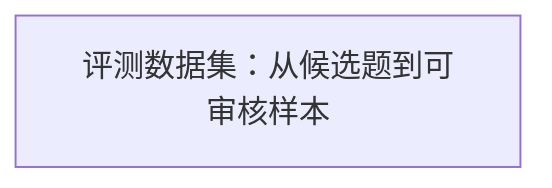

# Tutorial: e08_datasets

模型给动作，Docker里的循环执行Bash，独立容器核实结果。

**Source Repository:** [None](None)

## Chapters

1. [评测数据集：从候选题到可审核样本](01_评测数据集_从候选题到可审核样本.md)

---

Generated by [AI Codebase Knowledge Builder](https://github.com/The-Pocket/Tutorial-Codebase-Knowledge)