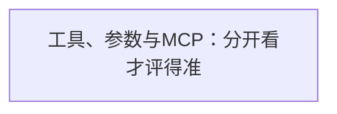

# Tutorial: e10_tool_evaluation

模型给动作，Docker里的循环执行Bash，独立容器核实结果。

**Source Repository:** [None](None)

## Chapters

1. [工具、参数与MCP：分开看才评得准](01_工具_参数与mcp_分开看才评得准.md)

---

Generated by [AI Codebase Knowledge Builder](https://github.com/The-Pocket/Tutorial-Codebase-Knowledge)