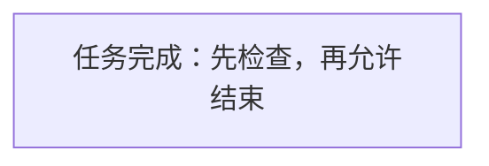

# Tutorial: e11_task_completion

模型给动作，Docker里的循环执行Bash，独立容器核实结果。

**Source Repository:** [None](None)

## Chapters

1. [任务完成：先检查，再允许结束](01_任务完成_先检查_再允许结束.md)

---

Generated by [AI Codebase Knowledge Builder](https://github.com/The-Pocket/Tutorial-Codebase-Knowledge)