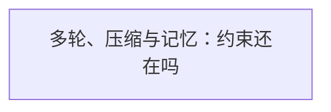

# Tutorial: e12_conversation

模型给动作，Docker里的循环执行Bash，独立容器核实结果。

**Source Repository:** [None](None)

## Chapters

1. [多轮、压缩与记忆：约束还在吗](01_多轮_压缩与记忆_约束还在吗.md)

---

Generated by [AI Codebase Knowledge Builder](https://github.com/The-Pocket/Tutorial-Codebase-Knowledge)