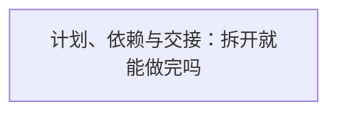

# Tutorial: e13_planning

模型给动作，Docker里的循环执行Bash，独立容器核实结果。

**Source Repository:** [None](None)

## Chapters

1. [计划、依赖与交接：拆开就能做完吗](01_计划_依赖与交接_拆开就能做完吗.md)

---

Generated by [AI Codebase Knowledge Builder](https://github.com/The-Pocket/Tutorial-Codebase-Knowledge)