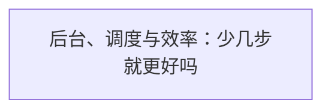

# Tutorial: e14_runtime

模型给动作，Docker里的循环执行Bash，独立容器核实结果。

**Source Repository:** [None](None)

## Chapters

1. [后台、调度与效率：少几步就更好吗](01_后台_调度与效率_少几步就更好吗.md)

---

Generated by [AI Codebase Knowledge Builder](https://github.com/The-Pocket/Tutorial-Codebase-Knowledge)