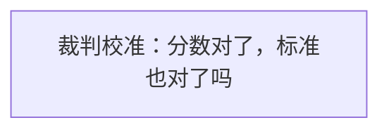

# Tutorial: e15_calibration

模型给动作，Docker里的循环执行Bash，独立容器核实结果。

**Source Repository:** [None](None)

## Chapters

1. [裁判校准：分数对了，标准也对了吗](01_裁判校准_分数对了_标准也对了吗.md)

---

Generated by [AI Codebase Knowledge Builder](https://github.com/The-Pocket/Tutorial-Codebase-Knowledge)