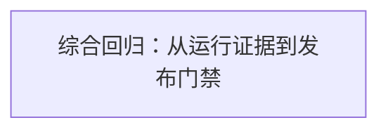

# Tutorial: e16_regression

模型给动作，Docker里的循环执行Bash，独立容器核实结果。

**Source Repository:** [None](None)

## Chapters

1. [综合回归：从运行证据到发布门禁](01_综合回归_从运行证据到发布门禁.md)

---

Generated by [AI Codebase Knowledge Builder](https://github.com/The-Pocket/Tutorial-Codebase-Knowledge)