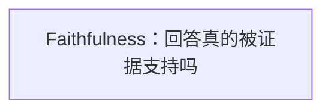

# Tutorial: s07_faithfulness

以证据支持关系连接知识、实现、实验与验收的单课样章。

**Source Repository:** [None](None)

## Chapters

1. [Faithfulness：回答真的被证据支持吗](01_faithfulness_回答真的被证据支持吗.md)

---

Generated by [AI Codebase Knowledge Builder](https://github.com/The-Pocket/Tutorial-Codebase-Knowledge)