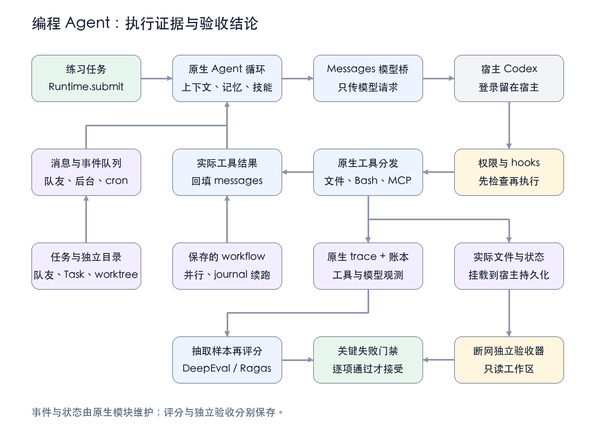

# 综合项目：一个会查知识库的编程 Agent

Agent 要修改运费函数与调用入口，查阅 TinyRAG 接入的项目规范，保留接口和原测试，再确认实际行为符合要求。

前面的课分别解释一个机制。这里把它们接到同一条执行循环上，再把真实记录送进评测。

## 先看整体



```text
用户任务 → Runtime → 模型 → 工具 → 工作区
                ↑             ↓
                └── 真实结果 ─┘

挂载知识库 → TinyRAG → 文档片段 → 模型上下文

请求与工具轨迹 → 评测样本 → DeepEval / Ragas
实际工作区与状态 → 规则检查 → 关键条件门禁
```

模型选择动作，运行时执行。评分器读取已发生的行为；独立规则再检查实际文件与状态。

## 从一个请求读起

[Runtime.submit](runtime.py) 将请求写入 history，进入原生循环。每轮组装工具、记忆和按需知识，执行前检查权限，执行后回填结果。

没有工具请求时，目标循环查看当前证据，决定返回还是带原因继续。后台仍在运行时可延后判断。模型停止以后，业务是否完成仍由外部状态检查确认。

## 知识库只是一个工具来源

`docs.search` 调用 [TinyRAG 适配](../eval_course/tinyrag.py)，从只读挂载目录取片段，返回文本、来源、版本与相似度。生成继续使用原 Agent 的模型入口。

默认本地 TF-IDF 让检索不依赖额外密钥；它是词法向量基线。评价时仍要分别检查召回、证据忠实度和答案质量。

## 任务长起来以后

计划保存显式步骤，Task 保存依赖与归属。一次性子会话用新消息列表处理局部工作，持久队友通过邮箱和任务表接收后续工作。worktree 提供独立工作副本。

上下文压缩保留当前请求与必要工具配对，磁盘记忆保存可跨会话的内容。后台进程稍后交回真实结果，调度提示收到以后还要执行相应动作。

工作流用 journal 保存成功步骤，恢复时复用同一输入对应的结果。目标循环、工作流完成和业务规则通过各自表达不同状态。

## 评测怎样接进来

[第16课采样器](../lessons/e16_regression/code.py) 通过响应 ID 找 trace，保留工具参数、返回和来源 UUID。DeepEval 与 Ragas 按各自定义评价回答及工具行为。

[verify.py](verify.py)读取实际代码并检查两个接口，`state.py` 核对任务、记忆、工作流与工作目录状态。关键条件有任何失败或未知，都阻止接受改动。

## 源码地图

| 文件 | 读什么 |
|---|---|
| [runtime.py](runtime.py) | 请求怎样进入循环，目标判断怎样续轮 |
| [transport.py](transport.py) | 模型响应怎样变成原生动作协议 |
| [workflows.py](workflows.py) | 并行检查、日志与恢复 |
| [traces.py](traces.py) | 实际模型与工具怎样被记录 |
| [scenario.py](scenario.py) | 完整任务的阶段连接 |
| [verify.py](verify.py)、[state.py](state.py) | 业务行为与持久状态怎样检查 |
| [gates.py](gates.py) | 缺少关键上下文时怎样阻止接受结论 |

知识库默认使用 `knowledge_base/e16`，只读挂载；工作区与运行记录分别持久保存。需要运行时，让 Codex 根据 Docker 配置准备一次新的任务即可。

[总体调用链](architecture.md) · [机制说明](capabilities.md) · [第16课](../lessons/e16_regression/README.zh.md) · [课程大纲](../docs/curriculum.md)
