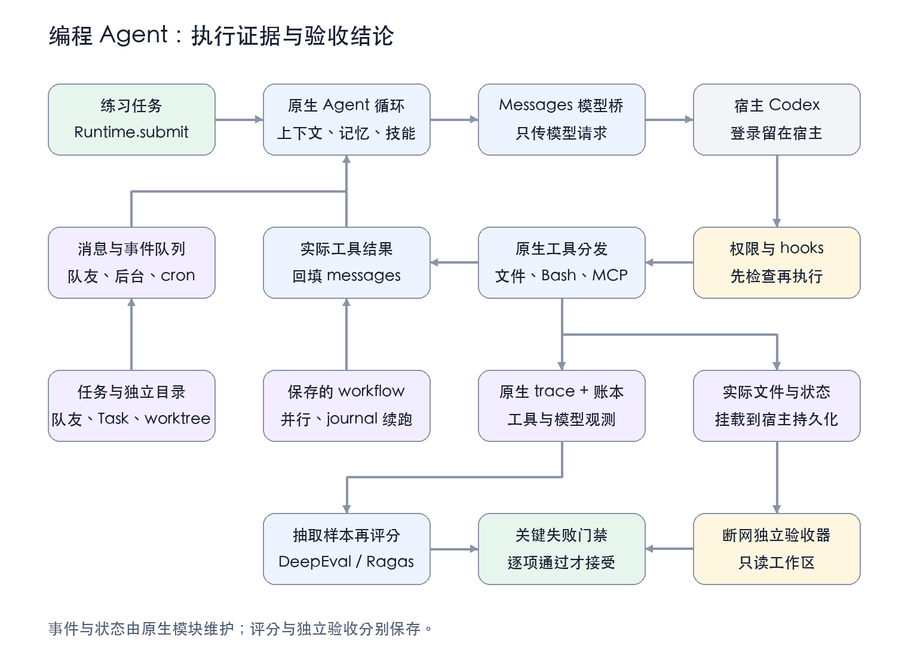

# 综合项目：一条请求怎样走完

从第1课到第15课，我们分别观察循环、检索、评分、任务与运行状态。综合项目把这些能力接到同一个编程 Agent 上。代码仍由模型决定怎样修改；讲师脚本负责安排实验阶段，并把审批和提交操作记为讲师行为。

图对应当前接线，重点展示执行、证据与验收的关系。[可编辑图](../lessons/e16_regression/images/integrated-runtime.drawio)单独保留。主循环内的 Goal 判断和压缩恢复在下面展开。

## 从哪里读起

先看 [runtime.py](runtime.py) 的 `Runtime.__init__`。它把固定版本的 s15 集成模块加载到指定工作区，让 s15 继续使用原生 s09 记忆；随后接入 s16 workflow 和 s17 GoalController。临时环境设置在加载后恢复，模型调用经过本机桥，知识工具读取挂载目录。四份上游代码没有改写，来源与哈希在 [provenance.json](https://github.com/lovits/learn-agent-evaluation/blob/main/vendor/learn_claude_code/provenance.json)。

适配层增加了请求账本、工具观测、知识读取与批处理授权，以及工作目录绑定事务。最后一处来自实际复现的并发丢失更新，见 [能力契约与限制](capabilities.md)。阅读时先在上游找到原始行为，再对照适配层确认课程增加了哪些接线。

## 一次普通任务

`Runtime.submit` 检查任务非空，取得 `agent_lock`，触发用户输入 hook，再把请求追加到 `history`。锁保护同一会话的消息修改；模型响应仍可能调用多个工具，也可能结束本轮。

`_goal_loop` 先调用原生循环。原生循环在每次请求前收取 cron、后台通知，运行上下文预算与压缩，再组装记忆、技能目录和当前工具池。`connect_mcp` 只改变已连接服务器；下一轮重新组装工具池后，模型才能调用新发现的具名工具。

`RecordedMessages.create` 保存实际发出的参数，再调用真正的 SDK。宿主 [integrated_bridge.py](../tools/integrated_bridge.py) 把 Messages 请求转换为模型可返回的 `answer` 与 `tool_calls`，容器随后执行工具。宿主模型没有进入练习目录执行 Bash；工具结果来自容器。

每个普通工具调用先经过 `PreToolUse`。拒绝时，拒绝原因直接成为相应 `tool_use_id` 的结果；允许时才分发 handler，触发 `PostToolUse`，把实际返回值写回消息。工具函数返回错误字符串时，trace 的函数调用状态仍可能为 `SUCCESS`，因为函数本身正常返回了。判断工具是否完成业务动作，还要读结果内容。

没有新工具调用后，原生循环触发停止 hook，并尝试提取长期记忆。公开 Goal 裁判随后只读取对话证据：未完成就带原因续轮；后台仍运行时延后判断；裁判异常、连续阻止达到上限或目标失败都有独立状态。`returned` 表示运行入口返回，最终业务结论由外部验收器给出。

## 任务、队友与工作目录

TodoWrite 是内存中的整张清单替换。Task 则保存在 `.tasks`，有稳定 ID、依赖和 owner。持久队友领取 Task 后，assignment 同时绑定任务 ID 和实际 cwd；文件操作使用这个目录。一次性 `task` 子 Agent 有自己的消息列表，返回摘要后结束；持久队友会进入 IDLE，等待消息或认领下一项就绪任务。

审批绑定当前任务与工作版本。队友提交计划后要等待当前请求的批准；旧任务的审批不能授权新任务。任务释放会重置 plan gate，因此后续任务仍需审批时，讲师或 Lead 必须重新提出要求。关机同样需要当前请求 ID 和正确发送方，普通消息不能伪造一次有效审批。

worktree 提供独立 working copy。组合实验中，队友在分支里写评审；讲师等待任务完成、IDLE 与关机确认后提交评审，再调用宿主侧移除函数。移除前检查任务、租约、后台 cwd 和未提交内容，移除后保留分支。它不限制进程在操作系统里的全部活动。

## 后台、调度与工作流

只有 `bash` 的 `run_in_background` 明确为布尔 `True` 时，才启动后台路径。主循环先收到占位结果，实际命令结束后收到一次完成或失败通知。进程组清理覆盖普通结束和 SIGTERM；另建 session 的进程可能脱离原组。

cron 调度器按真实时钟每秒检查。持久的一次性任务先写 `pending_delivery`，再入队，直到包含它的模型请求成功才确认删除。崩溃恢复可能再次交付，所以应按至少一次交付设计幂等动作。这个承诺没有扩展到“任意损坏文件都能恢复”。

workflow 的编排由可信脚本保存。`course-review` 并行检查 API 合同与测试覆盖，再把候选意见交给验证步骤。每个成功步骤按名称、prompt、schema 生成语义键并追加 journal；resume 读取同一个 run ID 的快照、参数和日志。命中缓存只表示复用先前结果，不会使错误意见变正确。实现细节和失败恢复见 [第16课源码导读](../lessons/e16_regression/source_walkthrough.md)。

## 证据怎样进入评测

[traces.py](traces.py) 在固定版本 DeepEval 完成 trace 的边界保存原生对象，再保留原来的结束动作。同步调用按真实 parent UUID 组织；新队友线程产生的独立根保留独立根，没有补造跨线程父子关系。请求账本另外保存每次发送、响应、错误和时间。

[第16课采样器](../lessons/e16_regression/code.py)通过原生响应 ID 找到修复轮的 trace，再保存工具名、实际参数、输出及源 span UUID。主 Agent 的文字、检索规范和测试输出各有来源。两种 Faithfulness 证据范围分别评分，避免把规范要求误当成操作已发生。

验收在另一个断网容器中读取工作区。业务四文件复制到受限检查环境，验证两个 API、签名、调用关系和原测试；原生任务、记忆索引、工作流日志、定时交付和 Git 工作目录另按状态合同检查。错误与越界任务还要把实际工具尝试、拒绝结果和文件保持情况连起来。模型的完成声明、团队摘要和框架高分都不会免除这些检查。

## 目录与使用顺序

| 目录或文件 | 使用时机 |
|---|---|
| `lessons/e01_*` 至 `lessons/e15_*` | 按课观察最小机制，保留各自独立实现 |
| `vendor/learn_claude_code` | 对照固定上游核心，查看原始机制 |
| `integrated_agent/runtime.py`、`transport.py` | 了解综合接线、权限与宿主模型边界 |
| `integrated_agent/scenario.py` | 运行讲师声明阶段的真实组合实验 |
| `integrated_agent/verify.py`、`state.py`、`negative.py` | 在执行后独立检查业务、状态和拒绝行为 |
| `knowledge_base/e16` | 只读挂载的练习规范，可换成自己的知识目录 |
| `workspaces` | 真实项目文件、原生状态和 Git 分支，失败现场保留 |
| `runs` | 每次新运行的原始报告，拒绝覆盖已有结果 |
| `integrated_agent/evidence` | 随仓库发布的固定实测证据，供复核与 CI 回放 |
| `references`、`generation` | 冻结协议、版本、资料依据、教材生成与审校记录 |

先按 [运行入口](README.md) 完成环境与一次任务，再读 [第16课](../lessons/e16_regression/README.zh.md) 把实验、采样和门禁连起来。自己的知识库和任务需要自己的成功合同，练习里的44条输入只服务这两个运费 API。
