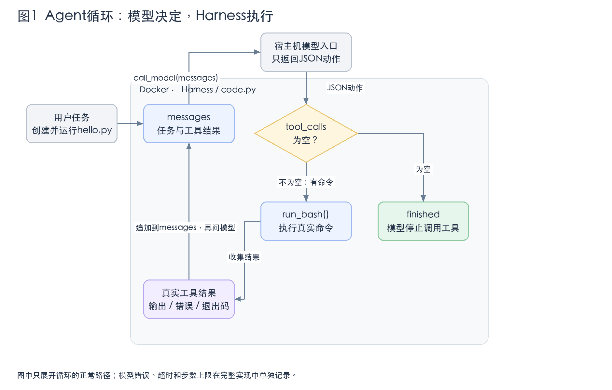
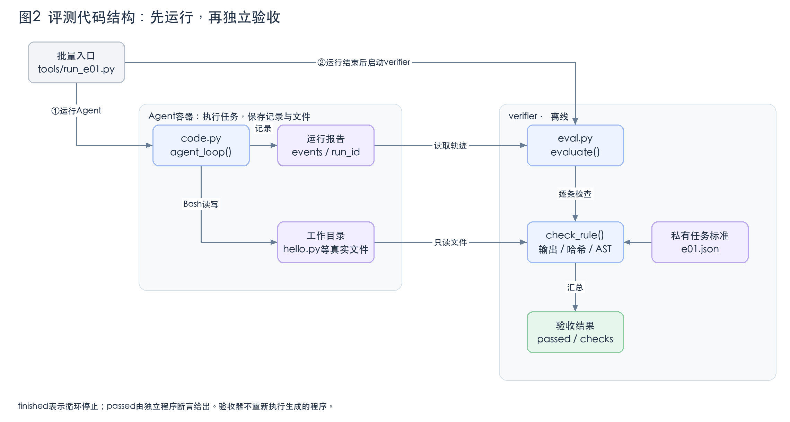

# e01: Agent 循环 — 模型停下以后，再看任务

[课程](../../README.md) · [下一课](../e02_tools_traces/README.zh.md) · [源码导读](source_walkthrough.md)

> 模型决定下一步，工具改变工作区，评分器检查任务要求。

## 一句“完成”还缺什么

让模型完成一个小任务：

> 创建 `hello.py`，只写一条 `print("Hello, World!")`，然后用 Python 运行。

模型可以马上回复“已经完成”。但文件在哪里？命令真的执行了吗？

先给模型一个 Bash 工具。它提出命令，我们执行，再把结果还给它。模型看到输出后，可以继续修改，也可以回答。



这就是最小 Agent：模型加上一段让动作发生的执行代码。执行代码也叫 Harness。

## 循环只有一个判断

[`agent_loop`](code.py) 先把任务放入消息，再不断请求模型。下面摘出它的主干，省略事件记录和异常分支：

```python
messages = [{"role": "user", "content": task}]
for step in range(1, max_steps + 1):
    response = model(messages)
    reply = response["reply"]
    messages.append({"role": "assistant", "content": reply})
    if not reply["tool_calls"]:
        return {"status": "finished",
                "final_answer": reply["answer"],
                "events": events}
```

`tool_calls` 非空，就执行工具；为空，就结束当前循环。`max_steps` 给循环设一个上限，防止它一直继续。

Learn Claude Code 的 s01 用 `tool_use` 表达动作。本课用 JSON 中的 `tool_calls` 传递 Bash 命令。协议形式变了，循环的职责相同。

## 命令在哪一刻真正发生

模型给出的命令仍是一段文本。`run_bash` 把它交给真实进程：

```python
with subprocess.Popen(
    command,
    shell=True,
    executable="/bin/bash",
    cwd=workspace,
    stdout=subprocess.PIPE,
    stderr=subprocess.PIPE,
    text=True,
) as process:
    stdout, stderr = process.communicate(timeout=timeout)
```

`cwd=workspace` 决定命令在哪个目录工作。创建文件、运行脚本，都在这里发生。执行器保存标准输出、标准错误和退出码，再把结果放回消息：

```python
messages.append({"role": "tool", "content": results})
```

下一轮，模型就能根据实际错误修正命令。每条任务使用新目录，避免旧文件碰巧满足新任务。

## 停止和完成分开判断

`finished` 来自循环：模型不再请求工具。

任务是否完成，由 [`eval.py`](eval.py) 另行检查。它读取工作区和执行事件，确认文件内容符合要求，也确认成功的执行记录里有 `Hello, World!`。



评分器先收集每项判断，再汇总：

```python
for rule in criteria["checks"]:
    checks.append({
        "name": rule["name"],
        "passed": check_rule(rule, tools, workspace),
    })
```

返回结果中有两个不同用途的字段：

```python
"passed": all(c["passed"] for c in checks),
"score": sum(c["passed"] for c in checks) / len(checks),
```

`score` 帮我们看满足了多少条件；`passed` 要求全部条件成立。文件没创建时，其他项的高分不能让任务通过。

对于这个小任务，Python AST 可以检查“只有一条 print”，同时接受引号和空白的变化。它检查的是明确的代码结构要求。更一般的程序行为，要到任务完成度那一课继续处理。

## 第一份评测由什么组成

| 对象 | 在这里是什么 |
|---|---|
| 任务输入 | 创建并运行 `hello.py` |
| 实际输出 | 最终回答、工具事件和文件 |
| 评分标准 | 文件结构、执行结果、停止条件 |
| 一条样本 | 一次任务及其实际记录 |
| 数据集 | 多条有各自标准的任务 |

DeepEval 把样本与指标分开组织；Ragas 把应用执行与逐行评价接起来。本课先用简单规则理解这个分工，后面再接它们的原生指标。

还要先读任务要求。若任务是“运行这个错误脚本，告诉我错误”，非零退出就是应当观察到的事实。工具失败和任务失败没有固定的对应关系。

## 试一下

让 Agent 完成创建文件的任务，再找出三个位置：命令进入 `run_bash` 的地方、结果回到消息的地方，以及评分器读取文件的地方。

接着，把最终回答换成“完成了”，文件保持缺失。想一想：循环状态和任务评分分别会怎样？

[完整 Agent](code.py) · [评分代码](eval.py) · [练习](exercises.md) · [参考答案](solutions.md)

## 接下来

读写文件都靠 Bash 时，很难直接看出每个动作的意图。下一课把动作变成具名工具，再把每次调用整理成可评测的样本。
