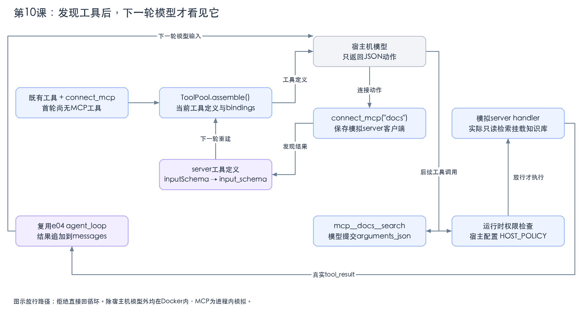

# e10: 工具调用质量 — 名字对了，还要看参数

[课程](../../README.md) · [上一课](../e09_comparison/README.zh.md) · [下一课](../e11_task_completion/README.zh.md) · [源码导读](source_walkthrough.md)

> 工具匹配、执行成功和任务完成，各自需要证据。

## read_file 读错文件算对吗

Agent 需要读取程序，把 `6 * 7` 改成 `6 * 8`，运行并保存结果。它确实调用了 `read_file`，但读的是另一个文件。

只数工具名，会把这次调用当成命中。再往下看，还可能发生漏调用、顺序错误，或用不同合法方法完成修改。

本课通过动态工具池连接新的工具来源，重点看每种工具指标究竟比较哪一部分。

## 工具先发现，下一轮才能选择

本课沿用 Learn Claude Code s14 的进程内 MCP 模拟：连接配置好的 docs 服务，发现 `mcp__docs__search`，下一轮再把它交给模型。



模型调用前重新组装工具：

```python
def model(messages):
    tools = pool.assemble()
    snapshots.append({"model_turn": len(snapshots) + 1, "tools": tools})
    return call_model(messages, tools)
```

`ToolPool` 保存规范化工具名与实际处理器的绑定。宿主策略决定能否运行，服务端的“只读”描述不能自己授予权限。

这里关注发现与分发，没有实现 MCP 的 stdio 或 HTTP 线协议。

## 先确定比较单位

| 比较单位 | 能发现什么 | 容易漏什么 |
|---|---|---|
| 工具名 | 选择了哪种动作 | 参数错误 |
| 名字与参数 | 路径、内容等是否匹配 | 先后顺序 |
| 调用序列 | 是否按要求先读后改 | 其他合法执行路径 |
| 调用集合 | 覆盖与多余调用种类 | 相同调用的重复次数 |
| 实际产物 | 业务是否完成 | 过程中的越权或浪费 |

参考轨迹是一条可行路径。除非任务明确要求路线，否则不能把它当成唯一正确解。

## DeepEval 的配置改变匹配规则

`ToolCorrectnessMetric` 默认按工具名与类型匹配。加入参数评价以后，再比较 `input_parameters`；开启 ordering 后，按加权最长公共子序列计算覆盖；exact match 则严格比较整个列表。

```python
metric = ToolCorrectnessMetric(
    model=model, eval_mode="llm", async_mode=False, **options
)
scores[name] = metric.measure(sample, _show_indicator=False)
```

`options` 在 [`metrics.py`](metrics.py) 中分别设置这些策略。仅凭类名无法知道这次用了哪一种。

非精确覆盖以预期调用数为分母，额外重复调用不一定扣分。传入 `available_tools` 时，原生实现还会请求模型判断工具选择，再取选择分与匹配分的较小值。

## Ragas 的序列与集合

`ToolCallAccuracy` 先检查名字序列对齐，再比较参数。flexible 模式允许调整顺序，但重复导致长度不同仍可能失败。

`ToolCallF1` 把完整 `(name, args)` 放入集合，用交集计算 precision、recall 和 F1。相同调用重复一次不会产生新集合元素。

手算假设正确三次调用后，又重复同一次读取：集合 F1 可以仍为1，严格序列却不通过。次数与效率应另行观察。

## 评价参数，要看当时知道什么

`ArgumentCorrectness` 让裁判判断参数是否合理。输入必须保留决策时已有的消息和工具结果。

```text
此前消息 + 已返回结果 → 当前模型决定 → 本轮工具调用
```

[`decision_contexts`](metrics.py) 先回填上一轮结果，再构造本轮评分输入。它不把本轮尚未发生的结果塞回过去，也不裁掉连接和资料后，再指责模型没有依据。

参数通过 schema、权限放行、执行成功和裁判认为合理，仍是不同判断。最终文件还要按业务要求检查。

## 试一下

保留工具名，换成错误路径；再保留正确参数，只交换顺序；最后重复一次相同调用。预测不同配置会给出什么判断。

再比较 `edit_file` 与 `write_file` 两种合法修改路径：哪一种条件是用户要求，哪一种只是参考实现的写法？

[动态工具](mcp_tools.py) · [工具指标](metrics.py) · [练习](exercises.md) · [参考答案](solutions.md)

## 接下来

工具层的正确不足以保证代码任务完成。下一课进入真实行为检查，并把这些检查写成自定义指标。
