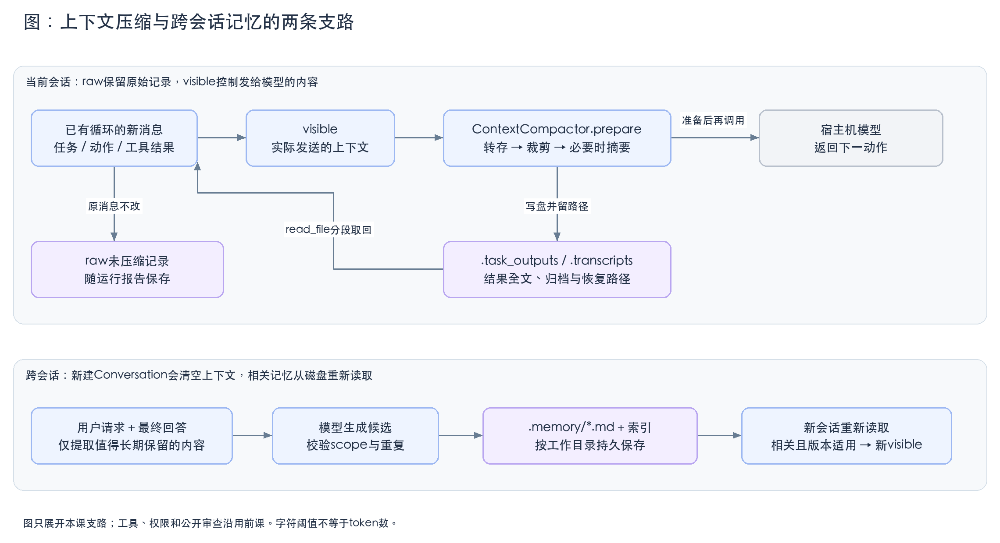

# e12: 跨轮约束 — 新要求来了，旧要求还剩什么

[课程](../../README.md) · [上一课](../e11_task_completion/README.zh.md) · [下一课](../e13_planning/README.zh.md) · [源码导读](source_walkthrough.md)

> 明确更新的规则被替换，未更新的约束继续有效。

## 从 300 改成 400，不该顺便改接口

运费任务连续收到需求：先修复函数，再把加急费从300改成400，最后在新会话把重量上限从5000扩到6000。

函数签名始终保持：

```python
shipping_fee(weight_grams, expedited=False)
```

记住旧费用并照用，是过期；改成400却把签名也改了，是丢约束。多轮评测要跟踪每条要求何时生效、何时被明确替换。

本课通过上下文压缩和持久记忆，让这个问题真正出现。

## 模型看到的历史与完整记录分开

`Conversation.visible` 是送给模型的消息；`raw` 保存未压缩动作。内部循环每次传来的 messages 已经累积，不能反复整段追加：

```python
self.visible.extend(copy.deepcopy(messages[seen:]))
seen = len(messages)
if self.compactor:
    self.visible = self.compactor.prepare(self.visible, active_request)
```

`seen` 标记已接入位置。每轮源码快照另存，后面才能按当时版本检查行为。



## 长结果先转存，再压缩旧消息

压缩器先保存完整工具结果，给模型预览与恢复路径；再归档旧中段，必要时才生成摘要：

```python
self.persist_results(messages, recent_only=True)
messages = self.snip(messages)
if size(messages) > self.limit:
    self.persist_results(messages, recent_only=False)
if size(messages) > self.limit:
    messages = self.summarize(messages, active_request)
```

裁剪要保护工具请求与结果配对，也要保留当前用户要求和最近的闭合工具批次。只留下“已经检查过”的摘要，可能丢掉模型继续判断所需的直接证据。

字符阈值只是压缩触发量，不等于模型 token 上限。

## 写盘之后，还得读得回来

[`PagedToolPool`](tools.py) 扩展 `read_file`，用字符偏移分页恢复：

```python
end = min(len(text), offset + limit)
return policy, {
    "status": "ok",
    "output": text[offset:end],
    "offset": offset,
    "next_offset": end,
    "total_chars": len(text),
    "truncated": end < len(text),
}
```

完整记录存在磁盘、模型收到一个预览、模型收到所有分页，是三个不同事实。`exposure.py` 根据实际模型输入合并已暴露区间，但无法证明模型理解了这些文本。

## 新会话从记忆取什么

新建 `Conversation` 清空旧消息，磁盘记忆仍可召回。候选先区分当前任务与长期事实，只存允许持久化的内容，再按版本筛选。

旧 v1 费用不应覆盖 v3 请求。记忆正文即使包含“改接口、删测试”，也只是背景数据，不会取得高于当前任务与权限的地位。

是否真的保住约束，最后要检查实际动作、签名与文件。

## 多轮指标怎样数

DeepEval `KnowledgeRetention` 从用户消息抽取知识，再判断助手是否遗忘。这里的 `yes` 表示发生遗忘，分数数的是 `no` 比例。

`ConversationCompleteness` 则先抽用户意图，再判断是否满足，这里的 `yes` 才是通过。两个指标的标签极性不同。

Ragas 用 `MultiTurnSample` 表示交互，本课以多轮 AspectCritic 写明“新规则替换旧规则，未改约束继续保持”。会话评分与每轮实际代码行为分开检查。

## 模拟用户也要检查覆盖

模拟器可以生成后续请求，并通过回调运行 Agent：

```python
result = agent.run_turn(input, current_version)
return Turn(
    role="assistant",
    content=result["final_answer"] or "Agent error; see runtime report",
)
```

这是 [`simulate.py`](simulate.py) 回调的核心。若模拟器第一轮就结束，后面的需求根本没有问到，就不能将其直接算成 Agent 没完成那些需求。

分别记录“问到了哪些阶段”和“收到要求后是否做对”。达到轮数上限也不等于任务完成。

## 试一下

依次提出费用更新和重量上限更新，列出每轮仍然有效的要求。压缩历史后，检查这些要求和最近工具结果在哪里。

再开启新会话，只保留磁盘记忆：旧费用和稳定接口约束，哪一种应当召回？

[会话](code.py) · [压缩](context.py) · [记忆](memory.py) · [练习](exercises.md) · [参考答案](solutions.md)

## 接下来

多轮要求已经能跟踪。下一课把目标拆给不同角色，继续检查计划、依赖和交接是否保住整体要求。
