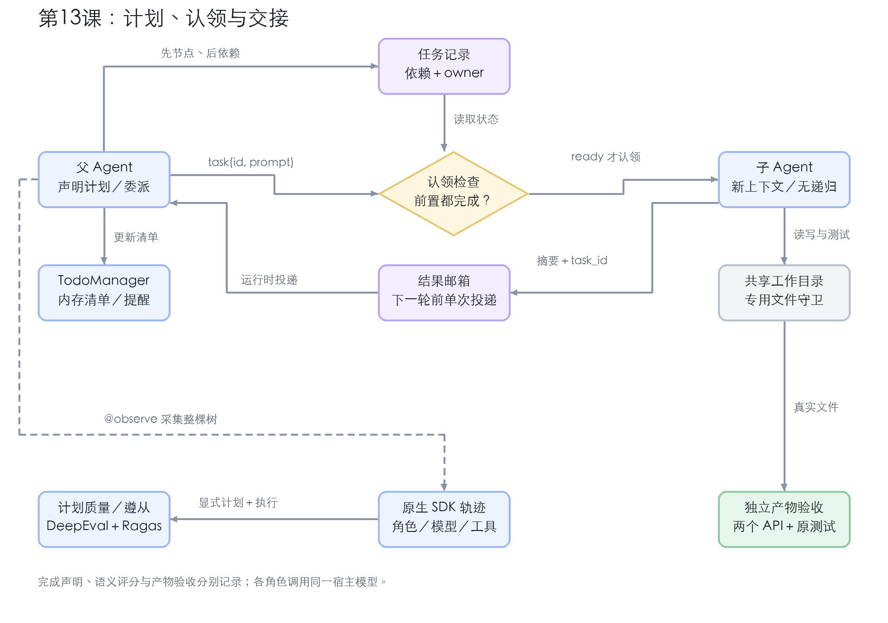

# e13: 计划与协作 — 局部完成怎样接成整体

[课程](../../README.md) · [上一课](../e12_conversation/README.zh.md) · [下一课](../e14_runtime/README.zh.md) · [源码导读](source_walkthrough.md)

> 计划、执行记录和最终结果，分别评价。

## 两个角色都说完成了

这次修两个文件：`shipping.py` 计算费用，`checkout.py` 的 `quote` 调用它。

核心函数修好，入口却漏传 `expedited`，加急订单仍然算错。即使两个任务都标成 `completed`，整条调用链也没有完成。

本课加入显式计划、任务依赖和一次性子会话，观察局部结果怎样交接，再分别评价计划是否合理、执行是否遵从、整体是否正确。

## 清单说明打算，任务表说明归属

`TodoManager` 保存声明的步骤。更新前先校验整个数组，再整体替换，避免写入半份计划。

```python
if sum(i["status"] == "in_progress" for i in items) > 1:
    raise ValueError("Only one todo may be in_progress")
self.items = copy.deepcopy(items)
self.rounds_without_update = 0
```

清单本身不会修改代码。持久的 `TaskStore` 另存任务 ID、依赖、owner 和状态。

父角色先创建任务，取得真实 ID，再加依赖。核心完成后，入口任务才可以认领。

## 依赖在认领时检查

[`TaskStore.claim`](state.py) 在共享锁内读取依赖，再修改归属：

```python
if any(self.load(d)["status"] != "completed" for d in task["blocked_by"]):
    raise ValueError("Dependencies are incomplete")
task.update(owner=owner, status="in_progress")
return self.save(task, "claim", owner)
```

依赖图还要拒绝环和不存在的节点。记录的 `completed` 是完成声明，工具层的局部检查为它提供依据，整体仍需独立检查。



## 子会话知道什么

[`run_child`](code.py) 给子角色新消息列表，只放任务说明、交接内容和文件范围，不复制父角色全部历史。

```python
pool = PlanningPool(self, owner, task_id, files)
before = copy.deepcopy(task)
result = self.run_session(context, pool)
task = self.store.load(task_id)
```

接口签名、当前费用与测试保护必须明确交接，或让子角色查询知识库。父角色不能假定新会话天然知道前面说过什么。

子角色只能通过专用工具修改分配文件；预期哈希用于拒绝过期覆盖。结果带任务 ID 写入邮箱，由父循环在下一次模型请求前消费一次。

## 原生轨迹把这些关系连起来

DeepEval `@observe` 分别标记 agent、llm 和 tool。父角色调用 `task` 的工具跨度下，会出现真实执行的子 Agent。

```python
@observe(type="tool", name="role_tool")
def dispatch(call, workspace, approve):
    update_current_span(
        name=call["name"],
        input={"actor": pool.actor, "task_id": pool.task_id, "call": copy.deepcopy(call)},
    )
    policy, result = pool.dispatch(call, workspace, approve)
```

这里摘出观察与执行的接入点，完整函数还保存返回值。父子关系帮助我们定位计划、认领和文件修改的来源，函数正常返回并不等于业务完成。

## 计划质量和遵从为什么分开

DeepEval `PlanQuality` 从任务与显式计划判断覆盖和顺序，`PlanAdherence` 再看执行是否符合计划。

好计划可能没有执行完，坏计划也可能被严格照做。固定版本没有提取到计划时默认返回1，必须同时检查“是否有计划”，不能理解成完美规划。

Ragas 在这里用 `DomainSpecificRubrics` 定义质量和遵从的1至5级标准。量尺与输入选择不同，不直接比较两个框架的裸分。

整体检查重新运行核心和入口，确认调用传参、文件范围与保护要求。只有局部通过，仍不足以接受整个项目。

## 试一下

让核心返回正确费用，但让 `quote` 忘记传加急参数。写出一个能区分“核心完成”和“整体完成”的输入。

再比较“好计划未执行”和“坏计划照做”。分别给计划质量、遵从与结果写出判断理由。

[协作循环](code.py) · [任务与邮箱](state.py) · [评分](eval.py) · [练习](exercises.md) · [参考答案](solutions.md)

## 接下来

同步子任务结束以后才能继续。如果一项检查需要等待，下一课把执行放到后台，并评价通知、调度和效率。
