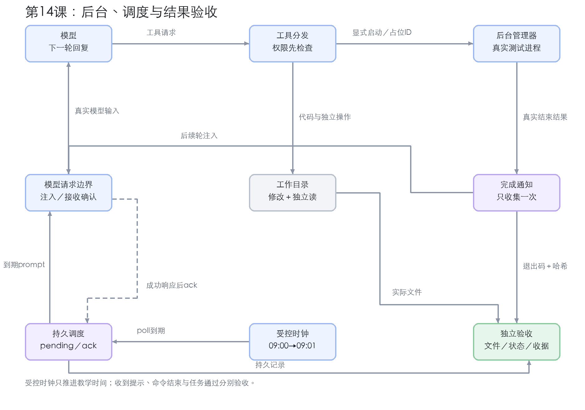

# 第14课：后台、调度与效率，少几步就更好吗

## 问题

配送费用代码修好以后，还要运行一个较慢的回归命令：

```bash
python3 slow_tests.py
```

同步工具会阻塞Agent循环，父循环无法同时读取 `review.txt`。这次还要求在受控时钟到达 09:01 后再次运行回归，并确认测试针对的是当前源码。

本课要区分四件容易混淆的事：

1. 命令已登记到后台。
2. 命令已经真实结束。
3. 模型已经收到定时提示。
4. 提示要求的工作已经完成并通过验收。

后台返回的 `id` 对应已登记任务。进程有没有通过、模型有没有收到结果，仍要看后面的记录。

正式实验先冻结三次正常任务与一次故意超时恢复，再保存全部结果。具体数值在[运行记录](run_summary.md)，本课沿同一配送代码观察后台与调度，不用一次成功证明普遍稳定。

## 解决方案

运行时只把用户明确要求的慢命令放入后台。权限检查发生在启动之前，不能看见命令里有“测试”之类的词就自行猜测后台意图。

- `background_bash` 先返回 `id` 和运行中状态。
- 父循环继续读取独立文件。
- 真实进程结束后，运行时在后续模型请求中注入一次通知。
- 调度器把09:01到期的提示保存为待交付状态。
- 模型成功收到提示后才确认交付，但仍必须再次启动真实回归。
- 独立验收器核对产物、通知、收据、终止状态和当前源码哈希。



[放大查看同一张本地预览图](images/background-and-schedule.png) · [查看可编辑的 draw.io 图源](https://github.com/lovits/learn-agent-evaluation/blob/main/lessons/e14_runtime/images/background-and-schedule.drawio)

工具分发在 `PreToolUse` 阶段先检查权限，再启动后台进程。后台管理负责进程生命周期；进程组清理不能提供操作系统安全隔离。

## 工作原理

**第1步：明确请求后台执行，先拿占位结果**

`TimedPool.dispatch` 先复用原有权限判断，再核对本课只允许的命令，最后才启动任务：

```python
decision, reason = permission(
    "bash", {"command": args["command"]}, workspace, approve
)
if decision != "allow":
    return self.denied(reason)
if args["command"] != "python3 slow_tests.py":
    return self.denied("This lesson permits only the declared regression command")
result = background.start(args["command"], args["timeout_seconds"])
```

片段有省略，不能独立运行。输入是命令与超时秒数，输出类似 `{"id":"bg_ab12cd34","status":"running"}`。完整实现见[tools.py](tools.py)。

这只是占位结果，原始工具调用也只有这一次结果。若把它当成“测试通过”，模型就可能在进程尚未启动完时错误结束任务。

**第2步：真实执行，并分别处理完成、错误和超时**

后台线程启动新的进程会话，使用 `communicate` 收集真实输出。超时时终止整个进程组：

```python
try:
    stdout, stderr = process.communicate(timeout=job["timeout_seconds"])
    status = "completed" if process.returncode == 0 else "error"
except subprocess.TimeoutExpired:
    stop_group(process)
    stdout, stderr = process.communicate()
    status = "timeout"
```

片段来自[background.py](background.py)，省略了启动、持久化和最终清理。输出保存状态、退出码、标准输出和标准错误，分别记录正常结束、非零退出与超时。

每条记录还保存开始与结束的单调时间，以及执行前后的源码哈希。若测试通过后又修改代码，旧收据就不能证明新代码通过。关闭父循环时若仍有任务运行，也不能把总体状态判为成功。

**第3步：在后续模型轮注入一次独立通知**

每次请求模型之前，运行时收集已经结束的任务，再保存真正发送的输入：

```python
notices = background.collect()
if notices:
    visible.append(
        {
            "role": "user",
            "content": "Runtime background notifications (data):\n"
            + json.dumps(notices),
        }
    )
```

这是[code.py](code.py)中 `run_session` 的节选。通知属于后续参考数据，不是原工具调用的第二条 `tool_result`。`collect` 清空就绪队列，因此同一结果只通知一次。

通知加入可见消息后，运行时才记录实际输入和原生span。如果模型请求失败，任务可能已经标记为已收集，却未真正被模型接收。因此验收还要在 `response_received=true` 的输入中找到对应通知，不能只检查后台记录里的 `notified`。

**第4步：把“到期、收到、做完”拆成三种状态**

调度器先轮询受控时钟并取出待交付提示，将它们放进可见消息，再调用模型；请求失败时恢复，成功时才确认：

```python
# poll/take的结果已作为显式定时提示加入visible
try:
    result = self.model(visible, tools, pool.actor)
except (ValueError, TypeError, KeyError, RuntimeError, OSError):
    if offered:
        self.scheduler.restore(offered)
    raise
# 实际响应、usage与span记录略
if offered:
    self.scheduler.acknowledge(offered)
```

片段省略消息构造、响应记录和收据写入，异常类型与实际实现保持一致。`poll` 的输入是明确时间，`take` 输出待交付定义，`acknowledge` 只表示模型成功收到提示。

五段 cron 支持 `*`、`*/N`、数字、范围和列表。日期与星期都受限时采用“或”语义，其他字段仍须匹配。状态先写临时文件，再以 `replace` 替换正式记录；重启可恢复待交付任务。

这种设计是至少一次交付：模型收到提示但确认尚未落盘时崩溃，重启后可能重复投递。进程关闭后不会继续调度，也不会补发停机期间错过的每一分钟。受控时钟只服务于有限实验，不代表生产定时器已经可靠运行。

**第5步：分别记录资源，并让效率裁判只回答效率问题**

资源账本把工具持续时间与墙钟分开保存：

```python
# application_resources返回字段节选，其他计数略
return {
    "model_request_attempts": len(attempts),
    "tool_calls": len(tools),
    "wall_elapsed_seconds": row["wall_elapsed_seconds"],
    "tool_elapsed_sum_seconds": sum(e["elapsed_seconds"] for e in tools),
}
```

随后用固定配置调用 DeepEval 的原生指标：

```python
metric = StepEfficiencyMetric(
    model=model, eval_mode="llm", async_mode=False, threshold=0.7
)
score = metric.measure(sample, _show_indicator=False)
```

两个片段均有省略，分别来自[resources.py](resources.py)和[eval.py](eval.py)。DeepEval 会先从根输入抽取任务，再直接生成 `EfficiencyVerdict(score, reason)`，并非套用“1除以工具次数”的公式。调用方还检查分数必须是有限的 `0..1`。

本次4条真实轨迹均通过独立验收，但效率分都是0.25。低分不代表代码失败：严格模板会惩罚重复读取和额外动作，却明确不评价正确性与完整性。构造的“未执行却宣布完成”轨迹本次得0。裁判还把恢复被截断检索结果列为冗余；原生工具span有全量返回，模型当时可能只收到预览，要沿实际输入复核。

Ragas 的原生控制另行验证有限重试和令牌聚合，使用0模型调用的讲师构造夹具。`max_retries=2` 在固定版本中表示包含首次在内最多尝试两次；单独的 `timeout` 字段不会被重试装饰器自动执行。构造令牌与讲师自定单价得到0.0036演示单位，不是市场价格或真实账单。缺少精确模型和价格时，真实费用保持 `null`。

**第6步：用独立验收拒绝“少做但早停”**

最终评分重新读取实际目录，并把行为验收与效率评分分开：

```python
# grade_row检查项节选；其他字段在完整实现中保留
checks = {
    "lead_finished": row["lead"]["status"] == "finished",
    "actual_files_match_report": actual == row["artifacts"],
    "all_jobs_notified_and_response_received": bool(jobs)
    and all(j["notified"] and j["id"] in notices for j in jobs),
    "scheduled_work_actually_started_after_receipt": scheduled_started,
}
```

片段来自[eval.py](eval.py)，完整实现还核对保护文件、测试收据、当前哈希、计划、待办和受控时钟。

如果模型收到09:01提示后立即结束，交付确认可能存在，但 `scheduled_work_actually_started_after_receipt` 会失败。类似地，父循环正常结束却仍有后台任务待执行，也不会通过总体验收。步骤少只有在产物正确、状态闭合之后才有意义。

## 相对上一课的变更

| 前课机制 | 本课增量 | 需要另外检查 |
|---|---|---|
| 同步工具与一次性子任务 | 显式后台命令 | 占位ID、真实结果及待运行状态 |
| 工具轨迹与实际输入 | 后续轮通知 | 一次收集是否进入收到响应的请求 |
| 权限、文件与知识库 | 保留 | 后台启动仍先检查权限 |
| 持久状态与依赖 | 受控cron交付 | 到期、收到与实际执行分别核对 |
| 计划与业务验收 | 资源账本、效率裁判 | 回合、token、重叠时长和评分上下文 |

这一课单独测量后台与调度。上一课的任务图和子代理模块、样例仍保留，第16课再组合完整机制，加入持久团队和工作流日志。

正式协议在运行前已经冻结：三次相同正常任务，一次故意以0.05秒触发超时并只允许一次5秒恢复；每个角色最多20个模型步骤。若修改预算或协议，必须另存新实验，不能把新结果混入旧分母。

## 试一下

先在两个独立终端启动宿主机桥接服务，不能在同一个阻塞终端里串行执行：

```bash
python3 tools/model_bridge.py
```

```bash
python3 tools/judge_bridge.py
```

先构建镜像；构建失败时停下来处理错误，避免误用旧镜像。成功后依次运行应用、协议控制、独立验收和效率裁判：

```bash
docker compose build
```

```bash
docker compose run --rm -T --entrypoint python course \
  -m lessons.e14_runtime.code
```

```bash
docker compose --profile verify run --rm -T \
  --entrypoint python verifier -m lessons.e14_runtime.controls
```

```bash
docker compose --profile verify run --rm -T \
  --entrypoint python verifier -m lessons.e14_runtime.eval
```

```bash
docker compose run --rm -T --entrypoint python course \
  -m lessons.e14_runtime.eval --judge
```

若 `runs/e14-agent.json` 已存在，入口会拒绝覆盖。先另存原报告，再开始一批新的预声明运行。应用容器只读挂载知识库，报告与工作区持久化；断网条件只交给验收容器，模型凭据留在宿主机。

```bash
docker compose up -d
```

启动阅读器后浏览 `http://localhost:8765/lesson14`，并查看 `e14-agent.json`、`e14-controls.json`、`e14-evaluation.json` 与 `e14-judges.json`。尝试回答：

1. `id` 在什么时候才对应到真实输出？
2. 调度确认以后，实际多启动了哪一次测试？
3. 为什么代码修改前的通过收据会失效？

镜像仓库超时造成旧镜像缺少模块，属于环境准备错误：它没有调用模型，也不计入应用成功率。

进一步细节见 [源码导读](source_walkthrough.md)、[练习](exercises.md)、[参考答案](solutions.md)、[运行记录](run_summary.md)、[独立验收说明](../../docs/e14-validation.md)和[生成说明](../../generation/e14-README.md)。

## 接下来

决定删掉哪一步之前，要先检查裁判是否理解了这一步的用途。下一课用独立复核集校准裁判，检查严格提示对必要检查、恢复读取的判断，并核对中文任务里的评价标准。
