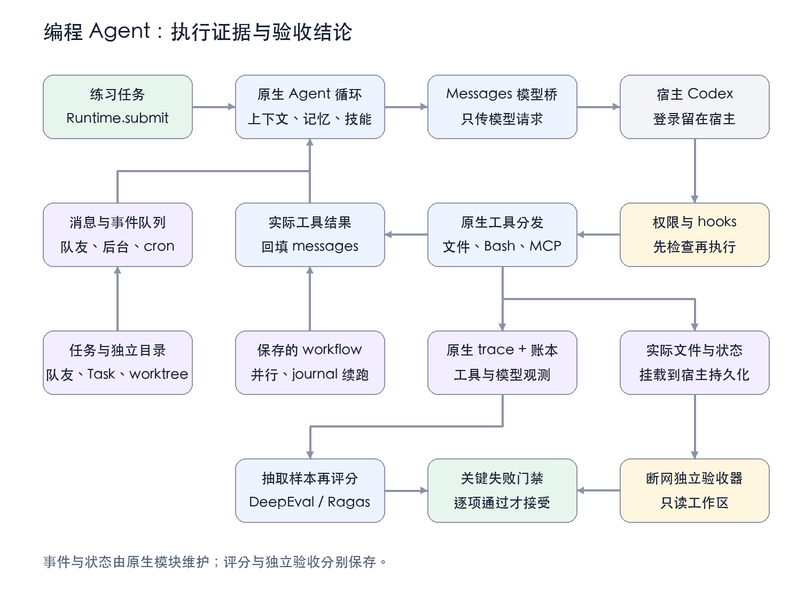

# e16: 持续回归 — 把评测接回完整 Agent

[课程](../../README.md) · [上一课](../e15_calibration/README.zh.md) · [源码导读](source_walkthrough.md)

> 从真实运行取样，让关键条件决定能否接受改动。

## 现在把这些部分接起来

前面分别看过检索、回答、工具和状态。完整 Agent 会把它们混在一次任务里：查知识库、改代码、委派检查、等后台结果，再报告完成。

本课把它们接成一条评测链。核心问题是：评分器拿到的样本，能否追溯到真正发生的动作？



## 一次任务从同一个入口进入

综合项目的 [`Runtime.submit`](../../integrated_agent/runtime.py) 把请求写入历史，再调用接入目标审查的原生循环：

```python
self.history.append({"role": "user", "content": query})
self.host.agent_loop(self.history, self.context, query)
return self.snapshot()
```

工具在工作区运行，知识库只读挂载。计划、子任务、记忆、后台和调度沿已学机制进入同一运行时；目标判断在返回边界决定继续或停止。

模型仍负责选择动作。组合场景中的阶段安排与明确批准由场景脚本承担，二者在轨迹里分别标明。

## 工作流恢复的是哪一步

可信评审脚本先并行看接口合同与测试覆盖，再核验候选意见：

```python
candidates = await ctx.parallel([
    lambda: inspect("API-contract"),
    lambda: inspect("test-coverage"),
])
```

每个成功步骤把输入与结果写进 journal。恢复时，用步骤名、提示和 schema 的语义键匹配已有结果。

命中缓存说明复用成功记录，不能证明旧意见正确。评审只看到实现文件时，也不能据此断言整个项目没有测试。

## 轨迹先保留实际参数与输出

请求账本保存真正发出的消息和模型响应；原生 trace 保存调用关系。通过响应 ID 找到对应 trace，再按时间提取工具 span：

```python
message_id = worker["response"]["id"]
tools = sorted(trace.get("toolSpans", []), key=lambda s: s["startTime"])
```

样本保留来源 UUID、工具名、参数与输出。只留一个 `OK`，无法判断它来自执行测试，还是打印文字；命令本身也是证据。

同步调用保留真实父子关系，队友线程产生独立根时保持独立，不补造调用树。

## 同一回答可以有不同证据范围

“原测试已通过”不能从“必须保留原测试”的规范推出。它需要实际执行记录。

因此 Faithfulness 样本分别用规范文档和观察到的工具行为作证据。证据范围不同，回答不变也可能获得不同裁决。这个差异不能归因于 Agent 能力变化。

工具指标则使用明确的局部投影，例如指定的两次文件读取。它诊断这部分轨迹，不代表所有任务只有唯一调用顺序。

## 最后接到关键条件

评分分开保存。业务行为、权限和必需状态先按规则检查，回答与轨迹再交给相应语义指标。

[`critical_gate`](code.py) 逐项接受严格为真的条件：

```python
rejected = [
    name for name, passed in checks.items()
    if passed is not True
]
```

任一必需项为假或未知，都阻止接受改动，不能靠其他高分平均掉。逐样本分数帮助定位，门禁执行已经声明的接受政策。

将查明的失败加入固定回归：缺少调用、未提供测试上下文、空裁决、权限拒绝或未完成状态。CI 可以反复检查这些确定条件，模型评价另按固定数据与配置执行。

## 试一下

从一次完整运行找出：响应 ID、对应工具 span、文件状态和原生指标输入。删掉其中一个工具读取的样本副本，说明哪些分数会改变，原 Agent 有没有发生变化。

再将一个关键条件设为未知，检查门禁为何必须保留拒绝原因。

[综合项目](../../integrated_agent/README.md) · [采样与门禁](code.py) · [双框架评分](eval.py) · [练习](exercises.md) · [参考答案](solutions.md)

## 用到自己的项目

先定义自己的任务与成功条件，准备带版本的知识库和数据，再保存实际执行轨迹。选指标时明确比较对象、方向、分母和空值约定；发现失败以后，把能够独立确认的条件加入回归。

到这里，模型输出、运行证据、评分结果与接受政策已经各有位置。你可以沿这条链解释一次具体失败，也可以用相同任务比较下一版 Agent。
